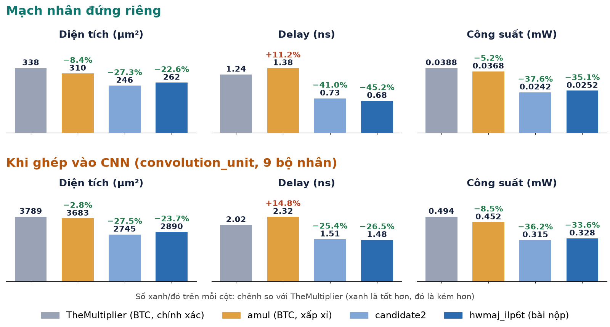
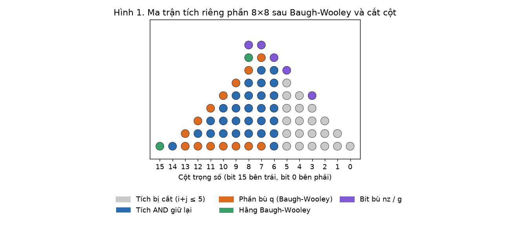

# Approximate Signed INT8 Multiplier for CNN Accelerators (`hwmaj_ilp6t_asic`)

> **AI Accelerator Design Challenge 2026**, Faculty of Electrical and Electronics Engineering, HCMC University of Technology and Education (HCMUTE)
> **Track 2:** approximate 8-bit multiplier (**signed INT8, two's complement**) for a CNN accelerator with fixed weights
> **Team:** `it rained in the afternoon` — **1st Prize**, Track 2
> **Finals submission:** **`hwmaj_ilp6t_asic`** (`asic/rtl/hwmaj_ilp6t_asic.v`)

[](LICENSE)


**Language:** [Tiếng Việt](README.md) · English

> Most of the in-depth documentation (`docs/`) and the figure captions are written in Vietnamese. This page summarizes the design and results in English.

---

## Highlights

- **Low error:** MAE = 27.29 over all 65,536 input pairs, 34% lower than our earlier design `candidate2` (41.24). The output is exactly 0 whenever either operand is 0.
- **CNN accuracy preserved:** 93.00% on MNIST (1,000 images) vs. 92.40% with an exact multiplier. The 0.6-point difference is not statistically significant (see §2.2).
- **Small and fast:** the `convolution_unit` (9 multipliers) reaches 2,889.8 µm², 1.484 ns and 0.328 mW in Nangate 45nm. Standalone multiplier: 262.0 µm², 0.6805 ns, 0.0253 mW.
- **ILP-optimized compressor tree:** 29 full adders, 0 half adders, 6 stages, arranged by signal arrival time.
- **Exhaustively verified:** the RTL matches an independent reference model on 65,536 / 65,536 input pairs.



*Green/red numbers above each bar: change relative to the organizers' exact `TheMultiplier`. The organizers' baseline numbers come from an earlier measurement (see footnote † in §2.3). Figure labels are in Vietnamese: "Diện tích" = area, "Công suất" = power, "Mạch nhân đứng riêng" = standalone multiplier, "Khi ghép vào CNN" = inside the CNN `convolution_unit`.*

---

## Quick start

### Exhaustive verification (no commercial tools needed)

Requires [Icarus Verilog](https://steveicarus.github.io/iverilog/) (or any Verilog simulator):

```bash
iverilog -g2005 -o sim_exhaustive asic/rtl/hwmaj_ilp6t_asic.v asic/verification/tb_hwmaj_ilp6t_exhaustive.v
vvp sim_exhaustive
```

Expected last lines: `TOTAL=65536  MISMATCH=0  ZERO_INPUT_ERR=0` and `RESULT: PASS (65536/65536)`. The testbench compares the RTL against an independently written model (`expected = a*b - T + comp`) and also reports ME, MAE and the maximum error.

> Note: the 65,536/65,536 result was obtained during the competition. The Icarus command above is the way to re-run it; it was not re-tested with Icarus while preparing this documentation.

### ASIC synthesis

Requires Yosys 0.52, OpenSTA 3.1.0 and the Nangate Open Cell Library `normal.lib`:

```bash
python asic/scripts/run_single_asic.py hwmaj_ilp6t_asic
```

The script looks for the module under `asic/rtl/`, runs Yosys and OpenSTA, and writes area/STA reports. The environment files (`asic/env/`: `normal.lib`, `constraints.sdc`, `synthesis.ys`, `run_sta.tcl`) are not included in this repository and come from the organizers' package. See [asic/README.md](asic/README.md) (Vietnamese) for the exact flow and constraints (10.0 ns clock, 2.0 ns input/output delay, 0.01 pF load, `BUF_X1` driver).

---

## Design

The multiplier targets the MAC unit of a CNN with fixed weights and no retraining. It has four parts:

1. **Truncate 21 partial products in the 6 low columns (`i + j <= 5`).** Partial products from column 6 upward are kept in full. Error convention: error = approximate − exact.
2. **Dynamic majority-based compensation.** For the 6 low bits of each operand, compute `ma` and `mb` (majority over two 3-bit groups) and a flag `nz` (both operands non-zero in the low 6 bits). A small table gives `g`, and the compensation is `comp = 64·g + 40·nz`. It varies with the input pair, unlike the fixed +81 constant of our earlier `candidate2`. This technique is a variant of popcount-based compensation (see TI patent US 10,372,415); it is **not** claimed to be a novel idea.
3. **6-stage ILP compressor tree, arrival-time aware.** The solution was found with PuLP and HiGHS: 29 full adders, 0 half adders. Late-arriving compensation bits are wired into the latest-arriving input pin of the full adders.
4. **Final addition `p = v1 + v2`** using Yosys's default adder. A prefix adder was tried and gave worse results.

A step-by-step explanation with hand-computed examples is in [docs/Giai_thich_bo_nhan_hwmaj_ilp6t.md](docs/Giai_thich_bo_nhan_hwmaj_ilp6t.md) (Vietnamese).



---

## Results

### Error (all 65,536 pairs, error = approximate − exact)

| Metric | candidate2 (constant +81) | hwmaj_ilp6t (dynamic compensation) |
| :--- | :---: | :---: |
| MAE | 41.24 | **27.29** |
| ME | +0.12 | −1.49 |
| Error range | [−240, +81] | [−153, +104] |
| Exactly correct pairs | 751 (1.15%) | **3,792 (5.79%)** |
| NMED (divided by 32,400) | 0.001273 | **0.000842** |
| MAE on MNIST-like distribution* | 9.94 | **6.60** |

\* MNIST-like distribution: 200,000 samples with pixels from the first 200 MNIST images and weights from 36 real weights, seed 1. This number depends on the sample.

### CNN accuracy (MNIST, 1,000 images)

| Configuration | Accuracy |
| :--- | :---: |
| Exact multiplier | 92.40% |
| candidate2_asic_dadda | 92.40% |
| hwmaj_ilp6t | **93.00%** |

Of the 22 images whose result differs from the exact multiplier, 14 become correct and 8 become wrong. A two-sided sign test gives p ≈ 0.29, so the 0.6-point difference is **not statistically significant**. What is solid: the error drops by 34% without lowering CNN accuracy.

### PPA (organizers' flow: Yosys 0.52 + OpenSTA, Nangate 45nm)

**`convolution_unit` (9 multipliers):**

| Metric | candidate2_asic_dadda | hwmaj_ilp6t_asic | Change |
| :--- | :---: | :---: | :---: |
| Area (µm²) | 2,745.386 | **2,889.824** | +5.3% |
| Delay (ns) | **1.5064** | 1.4841 | −1.5% |
| Power (mW) | **0.3150** | 0.3280 | +4.1% |

Reports: `asic/reports/convolution_unit_hwmaj_ilp6t_area.rpt`, `asic/reports/convolution_unit_hwmaj_ilp6t_sta.rpt`. The candidate2 numbers are from an earlier measurement; its reports are not part of this repository.

**Standalone multiplier:**

| Metric | Organizers' `TheMultiplier` † | candidate2_asic_dadda | hwmaj_ilp6t_asic |
| :--- | :---: | :---: | :---: |
| Area (µm²) | 338.352 | **246.050** | 262.010 |
| Delay (ns) | 1.2408 | 0.7320 | **0.6805** |
| Power (mW) | 0.0388 | **0.0242** | 0.0253 |

† The baseline numbers come from an earlier README and were not re-measured in the latest update. The standalone numbers of hwmaj are recorded in [DECISIONS.md](DECISIONS.md) (DEC-052); the separate report file is not included.

### Trade-off

Compared with candidate2, hwmaj cuts error by 34% and keeps CNN accuracy, at the cost of +5.3% area and +4.1% power in the `convolution_unit`. Delay is almost unchanged there (−1.5%), so this should not be presented as a speed improvement.

---

## Known limitations

- ME is biased negative (−1.49), while candidate2 is close to 0. The compensation is not perfectly balanced.
- The MNIST-like numbers depend on a sample of 200 images and 36 weights.
- The 0.6-point CNN accuracy difference is not statistically significant.
- Several documents reference helper scripts under `scratch/` (e.g. `scratch/hwmaj_ilp.py`) that are not part of this repository, so the ILP solution and some figures cannot be regenerated from here yet.

---

## Repository layout

```text
.
├── asic/
│   ├── rtl/hwmaj_ilp6t_asic.v          # Finals submission (the only RTL)
│   ├── scripts/                        # Yosys + OpenSTA runners
│   ├── verification/                   # Exhaustive 65,536-pair testbench
│   └── reports/                        # Area and STA reports of convolution_unit
├── docs/                               # Technical explanation (Vietnamese) and figures
├── reports/                            # Finals presentation slides (.pptx)
├── DECISIONS.md                        # Technical decision log
├── LICENSE                             # MIT
├── README.md                           # Vietnamese overview
└── README.en.md                        # This file
```

---

## License

Released under the [MIT License](LICENSE).

## Team

Team `it rained in the afternoon`: Lê Nguyễn Đăng Khoa, Võ Trần Đăng Khoa (team lead), Huỳnh Lê Thanh Liêm, Nguyễn Nhật Minh, Trần Công Thiện.
