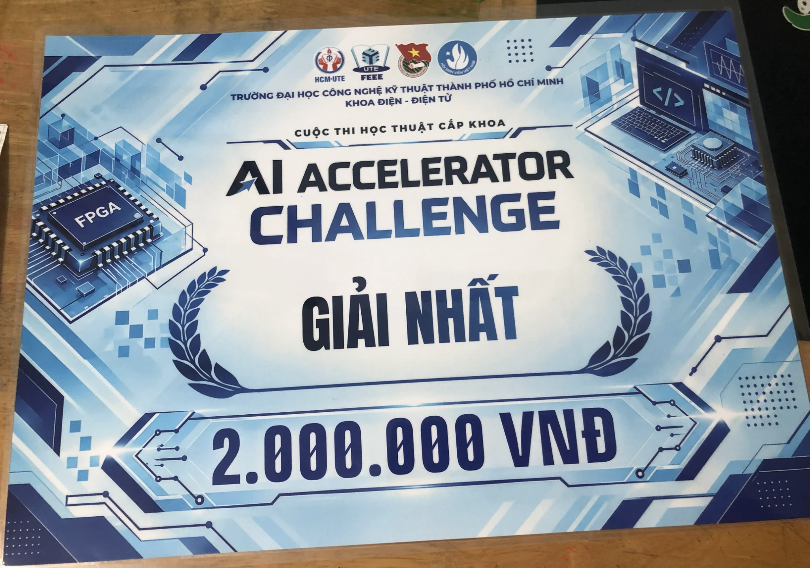
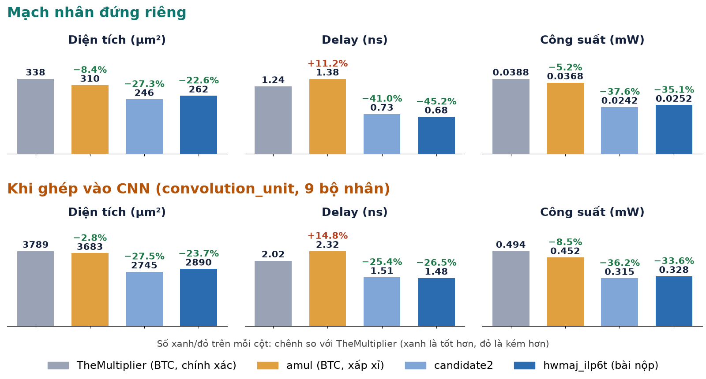
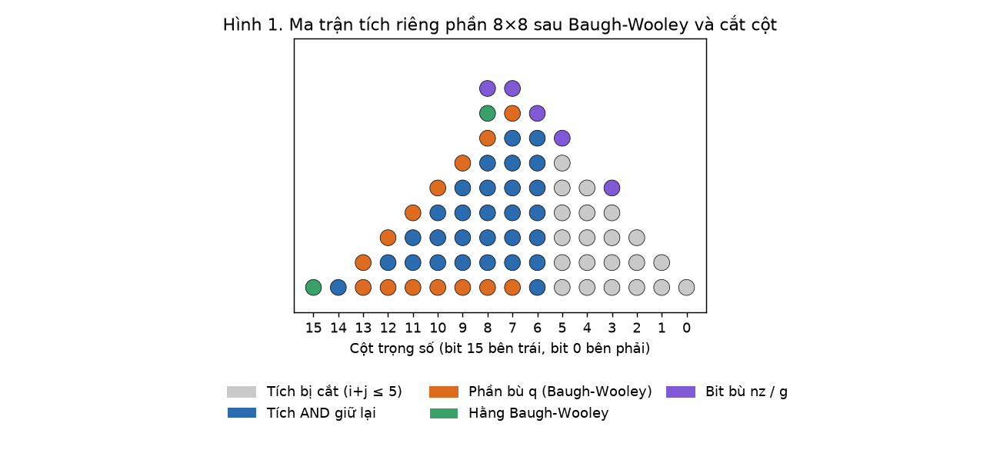
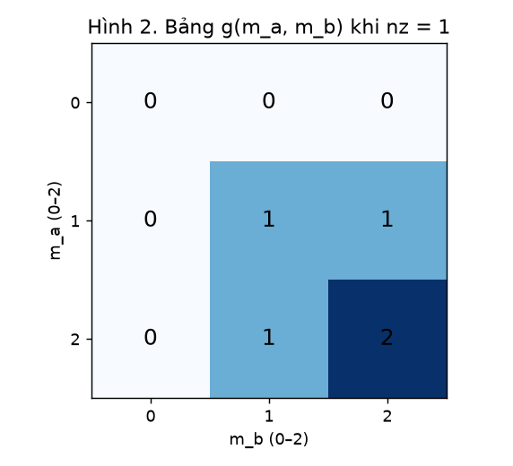

# AI ACCELERATOR DESIGN CHALLENGE 2026 — BỘ NHÂN XẤP XỈ SIGNED INT8

> **Cuộc thi Thiết kế Bộ gia tốc AI 2026** — Khoa Điện - Điện tử, Trường Đại học Công nghệ Kỹ thuật TP.HCM (HCMUTE)  
> **Track 2:** Mạch nhân 8-bit xấp xỉ (**Signed INT8, bù 2**) cho bộ gia tốc CNN với trọng số cố định  
> **Đội thi:** `it rained in the afternoon` — **Giải Nhất** Track 2  
> **Thiết kế nộp Vòng Chung kết:** **`hwmaj_ilp6t_asic`** (`asic/rtl/hwmaj_ilp6t_asic.v`)

[](LICENSE)


**Ngôn ngữ:** Tiếng Việt · [English](README.en.md)

<p align="center"></p>

---

## Tóm tắt

Bộ nhân xấp xỉ signed INT8 cho khối MAC của CNN với trọng số cố định. Thiết kế **`hwmaj_ilp6t_asic`** đã đạt **Giải Nhất Track 2** của cuộc thi.

- **Sai số thấp:** MAE = 27,29 trên toàn bộ 65.536 cặp đầu vào, giảm 34% so với bản `candidate2` (41,24). Đầu ra bằng 0 chính xác khi một toán hạng bằng 0.
- **Độ chính xác CNN giữ nguyên:** MNIST (1.000 ảnh) đạt 93,00%, nhân chính xác đạt 92,40%. Chênh lệch này không có ý nghĩa thống kê (xem mục 2.2).
- **Gọn và nhanh:** `convolution_unit` (9 bộ nhân) đạt 2.889,8 µm², 1,484 ns, 0,328 mW trên Nangate 45nm. Bộ nhân đứng riêng: 262,0 µm², 0,6805 ns, 0,0253 mW.
- **Cây nén tối ưu bằng ILP:** 29 Full Adder, 0 Half Adder, 6 tầng, sắp theo thời điểm đến của tín hiệu.
- **Kiểm chứng vét cạn:** RTL khớp mô hình tham chiếu độc lập trên 65.536/65.536 cặp.



*Số xanh/đỏ trên mỗi cột: chênh lệch so với `TheMultiplier` của BTC. Số baseline của BTC lấy từ lần đo trước (xem chú thích † ở mục 2.3).*

---

## Chạy nhanh

### Kiểm chứng vét cạn (không cần công cụ thương mại)

Cần [Icarus Verilog](https://steveicarus.github.io/iverilog/) (hoặc trình mô phỏng Verilog bất kỳ):

```bash
iverilog -g2005 -o sim_exhaustive asic/rtl/hwmaj_ilp6t_asic.v asic/verification/tb_hwmaj_ilp6t_exhaustive.v
vvp sim_exhaustive
```

Kết quả mong đợi ở cuối: `TOTAL=65536  MISMATCH=0  ZERO_INPUT_ERR=0` và `RESULT: PASS (65536/65536)`. Testbench so RTL với một mô hình tham chiếu viết độc lập (`expected = a*b - T + comp`) và tính luôn ME, MAE, sai số lớn nhất.

> Lưu ý: kết quả vét cạn 65.536/65.536 đã được chạy khi làm bài thi. Lệnh Icarus ở trên là cách chạy lại; chưa được thử trên Icarus trong lần chỉnh sửa tài liệu này.

### Tổng hợp ASIC

Xem [mục 5](#5-tái-lập-kết-quả): cần Yosys 0.52, OpenSTA 3.1.0 và thư viện `normal.lib` (Nangate Open Cell Library).

---

## 1. Thiết kế nộp Chung kết: `hwmaj_ilp6t_asic`

Bộ nhân xấp xỉ cho khối nhân tích lũy (MAC) của CNN, với trọng số cố định và không huấn luyện lại. Hàm của RTL đã kiểm tra khớp với mô hình tham chiếu trên 65.536/65.536 cặp đầu vào.

Kiến trúc gồm 4 phần:

1. **Cắt 21 tích riêng ở 6 cột thấp ($i+j \le 5$).** Các tích từ cột 6 trở lên được giữ lại đầy đủ. Quy ước sai số: sai số = xấp xỉ − đúng.
2. **Bù động theo đa số (majority).** Với 6 bit thấp của mỗi toán hạng, tính `ma` và `mb` (đa số trên hai nhóm 3 bit), cờ `nz` (cả hai toán hạng khác 0 ở 6 bit thấp), rồi tra bảng `g` để có bù `comp = 64·g + 40·nz`. Bù thay đổi theo cặp đầu vào, khác với hằng số cố định +81 của `candidate2_asic_dadda`. Kỹ thuật này là một biến thể của hướng bù dựa trên popcount, tham khảo sáng chế TI US 10,372,415. Đây không phải kỹ thuật chưa từng có.
3. **Cây nén ILP 6 tầng, sắp xếp theo thời điểm đến của tín hiệu.** Lời giải tìm bằng PuLP và HiGHS: 29 bộ Full Adder, 0 Half Adder. Các bit bù đến muộn được nối vào chân nhận tín hiệu muộn nhất của FA.
4. **Cộng cuối bằng `p = v1 + v2`** (bộ cộng mặc định của Yosys). Prefix adder đã thử và cho kết quả kém hơn.

Đầu ra bằng 0 chính xác khi `a = 0` hoặc `b = 0`, đã kiểm tra trên toàn bộ các cặp.

Giải thích chi tiết từng bước, kèm ví dụ tính tay từ dữ liệu thật: [docs/Giai_thich_bo_nhan_hwmaj_ilp6t.md](docs/Giai_thich_bo_nhan_hwmaj_ilp6t.md).

### Hình minh họa





---

## 2. Kết quả

### 2.1. Sai số (65.536 cặp đều, sai số = xấp xỉ − đúng)

| Chỉ số | candidate2 (hằng +81) | hwmaj_ilp6t (bù động) |
| :--- | :---: | :---: |
| MAE | 41.24 | **27.29** |
| ME | +0.12 | −1.49 |
| Khoảng sai số | [−240, +81] | [−153, +104] |
| Cặp chính xác tuyệt đối | 751 (1.15%) | **3.792 (5.79%)** |
| NMED (chia 32.400) | 0.001273 | **0.000842** |
| MAE trên phân bố kiểu MNIST* | 9.94 | **6.60** |

\* Phân bố kiểu MNIST lấy 200.000 mẫu: pixel từ 200 ảnh MNIST đầu, trọng số từ 36 trọng số thật, seed 1. Số này phụ thuộc vào mẫu.

### 2.2. Độ chính xác CNN (MNIST, 1.000 ảnh)

| Cấu hình | Độ chính xác |
| :--- | :---: |
| Nhân chính xác (exact) | 92.40% |
| candidate2_asic_dadda | 92.40% |
| hwmaj_ilp6t (cùng hàm `hw_maj_s64`) | **93.00%** |

Trong 22 ảnh đổi kết quả so với exact, có 14 ảnh đúng thêm và 8 ảnh sai thêm. Kiểm định dấu hai phía cho p ≈ 0.29. Chênh lệch 0.6 điểm vì vậy không có ý nghĩa thống kê. Điều chắc chắn là sai số giảm 34% trong khi độ chính xác không giảm.

### 2.3. PPA theo luồng BTC (Yosys 0.52 + OpenSTA, Nangate 45nm)

**`convolution_unit` (9 bộ nhân):**

| Chỉ số | candidate2_asic_dadda | hwmaj_ilp6t_asic | Thay đổi |
| :--- | :---: | :---: | :---: |
| Diện tích (µm²) | 2,745.386 | **2,889.824** | +5.3% |
| Delay (ns) | **1.5064** | 1.4841 | −1.5% |
| Công suất (mW) | **0.3150** | 0.3280 | +4.1% |

Báo cáo: `asic/reports/convolution_unit_hwmaj_ilp6t_area.rpt`, `asic/reports/convolution_unit_hwmaj_ilp6t_sta.rpt`. Số liệu candidate2 trong bảng là kết quả đo trước đây, báo cáo của nó đã gỡ khỏi repo.

**Bộ nhân riêng:**

| Chỉ số | BTC `TheMultiplier` † | candidate2_asic_dadda | hwmaj_ilp6t_asic |
| :--- | :---: | :---: | :---: |
| Diện tích (µm²) | 338.352 | **246.050** | 262.010 |
| Delay (ns) | 1.2408 | 0.7320 | **0.6805** |
| Công suất (mW) | 0.0388 | **0.0242** | 0.0253 |

† Số baseline lấy từ README trước đây và chưa được đo lại trong lần cập nhật này. Số liệu bộ nhân riêng của hwmaj ghi trong [DECISIONS.md](DECISIONS.md) (DEC-052), báo cáo riêng chưa được commit.

### 2.4. Đánh đổi

So với candidate2, hwmaj giảm 34% sai số và không làm giảm độ chính xác CNN. Đổi lại, diện tích `convolution_unit` tăng 5.3% và công suất tăng 4.1%. Delay gần như không đổi trong `convolution_unit` (−1.5%), nên không nên trình bày đây là cải tiến tốc độ.

---

## 3. Hạn chế đã biết

- ME lệch về phía âm (−1.49), trong khi candidate2 gần 0. Bù chưa cân bằng hoàn toàn.
- Số liệu kiểu MNIST phụ thuộc mẫu 200 ảnh và 36 trọng số.
- Chênh lệch 0.6 điểm độ chính xác CNN không có ý nghĩa thống kê.
- Testbench vét cạn 65.536 cặp nằm ở `asic/verification/tb_hwmaj_ilp6t_exhaustive.v`.

---

## 4. Cấu trúc thư mục

```text
.
├── asic/                                  # Luồng ASIC Nangate 45nm (Yosys + OpenSTA)
│   ├── env/                               # Thư viện và ràng buộc, không commit (xem asic/README.md)
│   ├── rtl/
│   │   └── hwmaj_ilp6t_asic.v             # Bài nộp Chung kết (RTL duy nhất)
│   ├── scripts/
│   │   ├── run_single_asic.py             # Tổng hợp và STA cho một module
│   │   └── run_convunit_asic.py           # Tổng hợp và STA cho convolution_unit
│   ├── verification/                      # Testbench vét cạn 65.536 cặp
│   └── reports/                           # Báo cáo diện tích và STA của convolution_unit
│
├── docs/
│   ├── Giai_thich_bo_nhan_hwmaj_ilp6t.md  # Giải thích kỹ thuật bộ nhân Chung kết
│   ├── figures/                           # Hình minh họa
│   ├── guide_line/                        # Hướng dẫn kiểm thử tự động
│
├── reports/
│   └── Bao_Cao_Chung_Ket_hwmaj_ilp6t_ASIC.pptx       # Slide Chung kết
│
├── DECISIONS.md                           # Lịch sử quyết định kỹ thuật
├── LICENSE                                # MIT
├── README.md                              # Tài liệu tổng quan (tiếng Việt)
└── README.en.md                           # English overview
```

---

## 5. Tái lập kết quả

### 5.1. Tổng hợp và STA cho một module

```bash
python asic/scripts/run_single_asic.py hwmaj_ilp6t_asic
```

Script tìm module trong `asic/rtl/`, chạy Yosys và OpenSTA, rồi ghi báo cáo vào `asic/reports/area_reports/` và `asic/reports/sta_reports/`. Cần có Yosys 0.52, OpenSTA 3.1.0 và thư mục `asic/env/`.

### 5.2. Lưu ý về môi trường

- `asic/env/` (gồm `normal.lib`, `constraints.sdc`, `synthesis.ys`, `run_sta.tcl`) bị `.gitignore` bỏ qua nên không có trong repo. Cần sao chép từ gói của BTC.
- `asic/scripts/run_convunit_asic.py` đọc `convolution_unit.v` trong gói BTC (không kèm theo repo), đặt tại `docs/Training2/ASIC/` hoặc chỉnh đường dẫn trong script.

---

## 6. Tài liệu liên quan

- [docs/Giai_thich_bo_nhan_hwmaj_ilp6t.md](docs/Giai_thich_bo_nhan_hwmaj_ilp6t.md): giải thích kỹ thuật bộ nhân Chung kết.
- [reports/Bao_Cao_Chung_Ket_hwmaj_ilp6t_ASIC.pptx](reports/Bao_Cao_Chung_Ket_hwmaj_ilp6t_ASIC.pptx): slide Chung kết.
- [DECISIONS.md](DECISIONS.md): lịch sử quyết định kỹ thuật.

---

## 7. Giấy phép

Mã nguồn và tài liệu được phát hành theo giấy phép [MIT](LICENSE).

---

## 8. Đội thi

1. **Lê Nguyễn Đăng Khoa**
2. **Võ Trần Đăng Khoa** — **Trưởng nhóm**
3. **Huỳnh Lê Thanh Liêm**
4. **Nguyễn Nhật Minh**
5. **Trần Công Thiện**
