# Ghi chú chuẩn bị slide và hỏi đáp: hwmaj_ilp6t_asic

Ghi chú này tổng hợp các nội dung đã bàn trong phiên làm việc 2026-11-12. Dùng để làm slide (10 phút) và chuẩn bị phản biện (10 phút). Mọi số liệu đều có nguồn ở mục 5.

---

## 1. Một câu tóm tắt bài nộp

Nhân INT8 có dấu, chính xác cho đầu vào thật của CNN MNIST. Nhân được cấu tạo từ ba kỹ thuật:
1. **Baugh-Wooley** để xử lý dấu.
2. **Cắt cột 0–5** để giảm số tích riêng phần, kèm bù sai số.
3. **Bù động** theo đếm đa số bit (majority) của hai toán hạng, và cây nén ILP 6 tầng.

Bài nộp là `asic/rtl/hwmaj_ilp6t_asic.v` (DEC-052). Đây là biến thể của candidate2, cùng hàm, khác cây nén và cách bù.

---

## 2. Dàn ý slide (gợi ý, khoảng 12–14 slide cho 10 phút)

| # | Nội dung slide | Ý chính cần nói | Hình gợi ý |
|---|---|---|---|
| 1 | Tiêu đề | Tên đội (cần sửa), tên bài toán | - |
| 2 | Bài toán | Nhân INT8 có dấu trong CNN; mục tiêu: diện tích, delay, công suất, sai số | - |
| 3 | Ý tưởng tổng thể | Baugh-Wooley + cắt cột 0–5 + bù động + cây ILP | Sơ đồ 4 khối |
| 4 | Baugh-Wooley | Đổi số hạng âm thành $q(x,y) = 1 - xy$, hằng $0x8100$ | Ma trận 8×8 (fig01) |
| 5 | Cắt cột và sai số | 21 tích bị cắt, $T = \sum_{i+j\le5} a_i b_j 2^{i+j}$, $e = comp - T$ | Ma trận có vùng xám |
| 6 | Vì sao bù động | $E[T] = 80.25$; $E[T \mid a] = \tfrac12\sum a_i(64-2^i)$; hằng tĩnh không đủ | Bảng hệ số $31.5, 31, 30, 28, 24, 16$ |
| 7 | Majority, nz, g | $m_a, m_b \in \{0,1,2\}$; $nz$ chặn bù khi một toán hạng có 6 bit thấp bằng 0; $g = \min(m_a, m_b)$ | Hình majority hai nhóm (fig02 và widget) |
| 8 | Vì sao $comp = 64g + 40nz$ | Cột trống trong cây; hồi quy $T \approx 43.8 + 60.4g$ | Đường hồi quy hoặc bảng lớp |
| 9 | Cây nén ILP | 6 tầng, 29 FA, 0 HA; ràng buộc $3f + 2h \le H$ | Sơ đồ tầng |
| 10 | Kết quả sai số | MAE 27.29 (candidate2: 41.24); ME −1.49; MaxE 153 | Biểu đồ cột MAE |
| 11 | PPA | Diện tích, delay, công suất so với candidate2 | Bảng PPA |
| 12 | Độ chính xác CNN | 93.00% so với exact 92.40%; chênh 6 ảnh trên 1000 | Bảng |
| 13 | Hạn chế và hướng phát triển | Xem mục 6 | - |
| 14 | Kết luận | Đánh đổi: +5.3% diện tích, −34% MAE | - |

---

## 3. Nội dung kỹ thuật đã bàn, dạng ghi nhớ

### 3.1. Baugh-Wooley (đã chứng minh từng bước, §2 của tài liệu)

- Trọng số bit dấu là $-2^7$. Các tích $a_7 b_j$ và $a_i b_7$ là số âm.
- Đổi dấu bằng $-xy = q(x,y) - 1$ với $q(x,y) = 1 - xy$.
- Các hằng $-2^k$ gộp lại: $C_0 = -2(2^{14} - 2^7) = -2^{15} + 2^8$.
- Mod $2^{16}$: $-2^{15} \equiv 2^{15}$, nên $2^8 - 2^{15} \equiv 2^8 + 2^{15} = 0x8100$.
- Kiểm: $a = b = -1$ cho $1$; $a = b = -128$ cho $16384$; $a = -1$, $b = 2$ cho $-2$.

### 3.2. Cắt cột và sai số (§3 của tài liệu)

- Số tích bị cắt: $\sum_{c=0}^{5}(c+1) = 21$.
- $T \ge 0$, nên không bù thì $e = -T \le 0$.
- Có bù: $p = ab - T + comp$, $e = comp - T$.

### 3.3. Hằng bù kỳ vọng (§4 của tài liệu)

- $E[a_i b_j] = \tfrac14$, nên $E[T] = \tfrac14 \sum_{c=0}^{5}(c+1)2^c = \tfrac{321}{4} = 80.25$.
- $E[T \mid a] = \tfrac12\sum_{i=0}^{5} a_i (64 - 2^i)$. Hệ số: $31.5, 31, 30, 28, 24, 16$.
- Hằng tĩnh của candidate2 là $+81$, không phải $+80$. Lý thuyết cho 80.25 nên 80 gần hơn về số học. Bản candidate2 chọn 81 vì đo trên 65,536 cặp cho ME tốt hơn ($+0.12$ so với $-0.87$).
- **Lỗi đã sửa:** trong câu trả lời trước tôi nói "bản nộp chọn 81". Điều đó sai. 81 thuộc candidate2. Bản nộp `hwmaj_ilp6t` không dùng 81.

### 3.4. Majority, nz và g (§5 của tài liệu)

- $\text{maj}(x,y,z) = xy \lor xz \lor yz$. Đây là OR, không phải cộng. Tại $(1,1,1)$ phép cộng cho 3, còn maj cho 1.
- Chi phí: 3 cổng AND và 2 cổng OR cho mỗi $\text{maj}_3$.
- $m_a = \text{maj}(a_0,a_1,a_2) + \text{maj}(a_3,a_4,a_5)$, $m_b$ tương tự. Cả hai thuộc $\{0,1,2\}$.
- $nz = (a[5:0] \ne 0) \land (b[5:0] \ne 0)$. Khi $nz = 0$ thì $T = 0$, nên $comp = 0$ và $e = 0$.
- Giới hạn của nz: $nz = 1$ không đảm bảo $T > 0$. Ví dụ $a = 2$, $b = 32$: $T = 0$, $comp = 40$, sai số $40$.
- $g = \min(m_a, m_b)$ khi $nz = 1$. Kiểm 9 ô: khớp hoàn toàn. RTL dùng `case` trên $\{nz, m_a, m_b\}$ và cho kết quả giống hệt min.
- **Trực giác "ghép cặp":** $g$ là số cặp bit 1 có thể ghép một-một giữa hai phía, tối đa là $\min(m_a, m_b)$. Đây là trực giác, không phải chứng minh tối ưu.
- **Giới hạn của min:** trung bình $T$ theo lớp không đơn điệu theo min. Lớp $(0,2)$ có $T$ trung bình 64.2 nhưng $g = 0$. Lớp $(1,1)$ có $T$ trung bình 80.3 và $g = 1$.

Bảng trung bình $T$ theo lớp ($nz = 1$, đã kiểm bằng Python):

| $(m_a, m_b)$ | $g$ | Số cặp | $T$ trung bình | $comp$ | $comp - T$ trung bình |
|:---:|:---:|---:|---:|:---:|:---:|
| (0,0) | 0 | 3600 | 22.8 | 40 | +17.2 |
| (0,1) hoặc (1,0) | 0 | 7680 | 42.8 | 40 | −2.8 |
| (0,2) hoặc (2,0) | 0 | 3840 | 64.2 | 40 | −24.2 |
| (1,1) | 1 | 16384 | 80.3 | 104 | +23.8 |
| (1,2) hoặc (2,1) | 1 | 8192 | 120.4 | 104 | −16.4 |
| (2,2) | 2 | 4096 | 180.6 | 168 | −12.6 |

### 3.5. Vì sao $comp = 64g + 40nz$ (lý do đã bàn)

**Lý do phần cứng:** bit bù phải nằm vào chỗ trống của cây nén, không thêm hàng.
- $g$ đi vào cột 6 và 7, nên đơn vị của $g$ là $2^6 = 64$. Trong RTL, `comp[6]`, `comp[7]` đi vào các bộ cộng đầy ở cột 6 và 7.
- $nz$ đi vào cột 3 và 5, nên $40 = 2^5 + 2^3$. Trong `v1` (dòng 133), `comp[5]` và `comp[3]` nằm ở vị trí đang bằng 0.

**Lý do thống kê:**
- Hồi quy $T$ theo $g$ trên các cặp có $nz = 1$ (khoảng 97% tổng số cặp): $T \approx 43.8 + 60.4\,g$. Hệ số chặn gần 40 và hệ số góc gần 64.
- Quét trên 65,536 cặp: với $G = 64$, $L = 40$ cho MAE nhỏ nhất trong khoảng 0–128. Với $L = 40$, $G = 64$ cho MAE nhỏ nhất trong lưới bước 8 từ 0 đến 256.
- Cách giải thích khác: hồi quy $T \approx 2.7 + 39.4\,(m_a + m_b)$. Hệ số 39.4 gần 40. Đây là kiểm tra chéo, không phải lý do trực tiếp, vì thiết kế dùng min.

**Điều chưa chứng minh được:** chưa có công thức giải tích cho 40 và 64. Hai số này là giá trị gần hồi quy, được làm tròn theo cách đặt bit. Số 64 = $2^6$ liên hệ với giới hạn cột 0–5 trong $E[T \mid a]$, nhưng đó là gợi ý, chưa phải chứng minh.

### 3.6. Cây nén ILP (§6 của tài liệu)

- Đồng nhất thức: $x + y + z = s + 2c$ (FA). $x + y = s + 2c$ (HA).
- Số bit cột $c$ sau tầng: $H_{s+1,c} = H_{s,c} - 2f_{s,c} - h_{s,c} + (f_{s,c-1} + h_{s,c-1})$.
- Ràng buộc: $3f + 2h \le H$; cuối cây mỗi cột còn tối đa 2 bit.
- Kết quả: 6 tầng, 29 FA, 0 HA. Kiểm: $6 + 9 + 4 + 4 + 3 + 3 = 29$. Lịch này khớp RTL (xem mục 5 và mục 13).
- Thứ tự theo thời điểm đến: bit bù đến muộn được đưa vào chân $z$ của FA.

### 3.7. Ví dụ tính tay (§5.6 của tài liệu, đã kiểm)

| Ví dụ | $T$ | $m_a$ | $m_b$ | $nz$ | $g$ | $comp$ | $e$ | $p$ (xấp xỉ) | $ab$ (đúng) |
|:---|---:|:---:|:---:|:---:|:---:|---:|---:|---:|---:|
| $92 \times (-51)$ | 108 | 1 | 1 | 1 | 1 | 104 | −4 | −4696 | −4692 |
| $64 \times (-51)$ | 0 | 0 | 1 | 0 | 0 | 0 | 0 | −3264 | −3264 |
| $127 \times (-127)$ | 63 | 2 | 0 | 1 | 0 | 40 | −23 | −16152 | −16129 |

Ví dụ 3 cho thấy giới hạn: $b_0 = 1$ là bit duy nhất của $b$ trong 6 bit thấp, nhưng nó không tạo đa số trong nhóm, nên $m_b = 0$.

---

## 4. Số liệu chốt để đưa vào slide

| Chỉ số | candidate2 (hằng +81) | hwmaj_ilp6t (bản nộp) | Nguồn |
|---|---:|---:|---|
| Diện tích convolution_unit (µm²) | 2745.386 | 2889.824 | `asic/reports/convolution_unit_hwmaj_ilp6t_area.rpt` (dòng 36) |
| Delay (ns) | 1.5064 | 1.4841 | DEC-052 |
| Công suất (mW) | 0.3150 | 0.328 | DEC-052 |
| MAE | 41.24 | 27.29 | DEC-048 và tái tạo bằng Python |
| ME | +0.12 | −1.49 | DEC-048 |
| Sai số lớn nhất | +81 (khoảng $[-240,+81]$) | âm 153, dương 104 | DEC-048; DECISIONS dòng 417 |
| Độ chính xác CNN (MNIST 1000 ảnh) | 92.40% (exact) | 93.00% | TASKS; DEC-048 |
| Slack STA | - | 4.5159 ns (MET) | `asic/reports/convolution_unit_hwmaj_ilp6t_sta.rpt` |

Chênh lệch:
- Diện tích: $2889.824 / 2745.386 - 1 \approx +5.3\%$.
- Công suất: $0.328 / 0.315 - 1 \approx +4.1\%$.
- Delay: $1.4841 / 1.5064 - 1 \approx -1.5\%$. Đây là mức dao động của ABC, không nên trình bày là cải tiến lớn.
- MAE: $27.29 / 41.24 - 1 \approx -34\%$.

Số liệu bộ nhân riêng (không gắn CNN): candidate2 246.050 µm², 0.7322 ns; hwmaj 262.010 µm², 0.6805 ns.

**Lưu ý về con số 93.00%:** cao hơn exact 92.40%. Chênh 0.6 điểm, tức khoảng 6 ảnh trên 1000. Theo §11 của tài liệu, p ≈ 0.29, nên không có ý nghĩa thống kê. Khi trình bày, nên nói "không kém exact" thay vì "tốt hơn exact".

---

## 5. Kiểm chứng đã làm trong phiên này (bằng Python)

- Bảng RTL `case` khớp $\min(m_a, m_b)$ trên cả 9 lớp.
- Ánh xạ maj OR khớp với "có ít nhất hai bit 1" trên 8 tổ hợp.
- $nz = 0 \Rightarrow comp = T = 0$ trên toàn bộ 65,536 cặp: 0 vi phạm.
- Mô hình tái tạo MAE 27.29 và ME −1.49, khớp DEC-048.
- Ba ví dụ tính tay khớp với bảng mục 3.7.
- Hồi quy $T \approx 43.8 + 60.4\,g$ trên các cặp $nz = 1$.
- Quét $L \in [0,128]$ và $G \in [0,256]$ (bước 8).

**Kiểm tra RTL (`asic/rtl/hwmaj_ilp6t_asic.v`), đã chạy lại:**
- Mô phỏng bằng yosys trên 65,536 cặp $(a,b)$, so với bảng tham chiếu `hw_maj_s64`: 0 sai khác. Kết quả lưu ở `build/work_asic/audit_ilp6t/` (tạm, không commit).
- Sai số từ RTL: MAE 27.29, ME −1.49, sai số lớn nhất +104, nhỏ nhất −153. Khớp với DEC-048 và DECISIONS.
- Ba ví dụ: $92 \times (-51)$ cho −4696; $64 \times (-51)$ cho −3264; $127 \times (-127)$ cho −16152. Khớp.
- 14 phần bù $q$ (pp có dấu `~`), hằng BW ở cột 8 và bit 15, 43 tích với $i+j \ge 6$: khớp.
- `ma`, `mb`, `nz`, bảng `g`, `comp = {g, nz ? 40 : 0}`: khớp.
- 29 FA, 0 HA. Số FA theo từng tầng và từng cột khớp lời giải ILP trong mục 13: tầng 1 gồm 6 FA ở cột 7, 8, 10, 11, 12. Đã kiểm theo thứ tự tên wire `s1..s29`.
- Bit bù $g$ và $nz$ nối vào chân $z$ của FA (`s10`, `s21`, `s25`). `comp[5]`, `comp[3]` nối thẳng vào `v1`.
- Bộ cộng cuối: `assign p = v1 + v2`.

**Lưu ý:** trước đó tôi kết luận lịch tầng không khớp RTL. Kết luận đó sai, do cách đếm độ sâu phụ thuộc bỏ qua việc bit chưa dùng được giữ lại trong pool và dùng ở tầng sau. Lịch "6 tầng" là đúng với RTL.

**Điểm chỉ là ước lượng, không phải đo:** thứ tự theo thời điểm đến dựa trên giả định trễ (tích riêng phần = 1, bit bù = 3.5 đơn vị) trong `scratch/tree_timing.py`. `comp[8]` được nối vào cây nhưng luôn bằng 0 vì $g \le 2$.

**Đã sửa trong tài liệu** (`docs/Giai_thich_bo_nhan_hwmaj_ilp6t.md`):
- §5.2: "1 OR" thành "3 AND và 2 OR".
- §5.1: thêm giới hạn của nz với ví dụ $a = 2$, $b = 32$.
- Thay mọi cách gọi cũ của phần bù bằng $q(x,y) = 1 - xy$.
- `docs/figures/fig01_pp_matrix.png`: đổi chú thích legend từ "NAND" thành "Phần bù q (Baugh-Wooley)". Chỉ sửa legend, các chấm dữ liệu giữ nguyên.

**Chưa sửa:**
- §8.2 của tài liệu: NMED dùng chia 32,400, trong khi bảng và README dùng 16384. Đây là sự không nhất quán cần quyết định.
- Ký hiệu trọng số bit (dùng chữ w) ở §2 Bước 1.

---

## 6. Hạn chế và điều cần nói thẳng khi trình bày

1. **Diện tích và công suất tăng:** +5.3% diện tích, +4.1% công suất so với candidate2. Đổi lại là MAE giảm 34%.
2. **Min không tối ưu theo kỳ vọng:** trung bình $T$ theo lớp không đơn điệu theo min (mục 3.4).
3. **Hằng 40 và 64 chưa có công thức giải tích:** chỉ có hồi quy và quét thực nghiệm, cộng với lý do cột trống.
4. **Cổng nz không bắt mọi trường hợp $T = 0$:** ví dụ $a = 2$, $b = 32$ cho sai số 40.
5. **Lỗi lớn nhất âm (−153)** xảy ra khi $T$ lớn. Sai số dư có cả hai chiều: ME −1.49 cho thấy bù hơi thấp.
6. **Độ chính xác CNN:** 93.00% không có ý nghĩa thống kê so với 92.40%.
7. **Phân bố:** MAE đo trên phân bố đều và trên mẫu MNIST nhỏ (200 ảnh, 36 trọng số). Phân bố thật có thể khác.
8. **Công suất:** đo bằng activity mặc định của luồng BTC, chưa đo với activity thật từ CNN.
9. **Giới hạn dải g:** mở rộng g lên 0–7 làm delay tăng, độ chính xác không cải thiện (DEC-048).
10. **Lý lịch so với nguồn:** chưa đọc được LOZDAM (2023) và Petra và cộng sự (TCSI 2009). Không được viết "chưa ai làm". Câu an toàn là: "trong các nguồn đã khảo sát, chúng tôi không thấy cách phân lớp theo majority nhóm 3 bit của cả hai toán hạng kèm cổng nz."

---

## 7. Câu hỏi phản biện dự kiến và gợi ý trả lời

**Nhóm A: Thiết kế và lý thuyết**

1. *Vì sao không dùng bù hằng số như candidate2?*
   Hằng số không phụ thuộc vào toán hạng, trong khi $E[T \mid a]$ phụ thuộc mạnh vào $a$. Bù theo majority cho phép bù thay đổi theo dữ liệu, với chi phí phần cứng nhỏ.

2. *Vì sao chọn majority ba bit mà không dùng popcount đầy đủ?*
   Popcount đầy đủ 7 bit cho MAE 15.63 (DEC-048) nhưng tốn diện tích đáng kể. Majority ba bit là cân bằng giữa chi phí và độ chính xác.

3. *Vì sao min mà không phải tổng hoặc tích của $m_a$ và $m_b$?*
   Min có trực giác ghép cặp: số cặp bit 1 khớp nhau tối đa là min. Bảng hiện tại là nghiệm minimax trong không gian $4^9$ bảng, trên 5 phân bố (DEC-048). Hồ sơ hiện chưa có so sánh trực tiếp giữa min và tổng hoặc tích, nên không nên nói là đã loại bỏ chúng.

4. *Min có tối ưu không?*
   Không tối ưu theo kỳ vọng. Trung bình $T$ theo lớp không đơn điệu theo min: lớp $(0,2)$ có $T = 64$ nhưng $g = 0$. Đây là giới hạn của bảng 9 lớp.

5. *Vì sao 40 và 64?*
   64 là trọng số của cột 6 và 7 (chỗ trống trong cây). 40 là $2^5 + 2^3$, đặt vào cột 5 và 3 (chỗ trống). Hồi quy $T \approx 43.8 + 60.4g$ cho giá trị gần đó, và quét tham số cho thấy 40 và 64 tối ưu trên lưới đã quét. Không có chứng minh giải tích.

6. *Nz có đảm bảo đầu ra đúng 0 khi một toán hạng bằng 0 không?*
   Có với $a = 0$, $b = 0$, và với $a$ hoặc $b$ là bội của 64. Đã kiểm trên 65,536 cặp. Nhưng nz không bắt mọi trường hợp $T = 0$, ví dụ $a = 2$, $b = 32$.

7. *Vì sao cắt cột 0–5 mà không cắt sâu hơn?*
   Lý do cụ thể cho mức cắt 0–5 chưa được ghi trong hồ sơ hiện có. Trả lời an toàn: mức cắt này là cấu hình chung của candidate2 và hwmaj, và đã được đo. Nếu bị hỏi về mức cắt khác, cần kiểm tra lại trước khi trả lời.

8. *Vì sao cây ILP 6 tầng?*
   Cây ILP cho 6 tầng, 29 FA, 0 HA. Với thứ tự theo thời điểm đến, bit bù đến muộn vào chân $z$. Kết quả delay 1.4841 ns, chênh −1.5% so với candidate2. Mức này không đáng kể so với dao động ABC.

**Nhóm B: Kết quả và số liệu**

9. *MAE 27.29 nghĩa là gì?*
   Trung bình sai số tuyệt đối trên 65,536 cặp đầu vào INT8 đầy đủ, đo bằng so sánh với $a \cdot b$ đúng.

10. *Vì sao có MaxE âm 153 và dương 104?*
    Sai số lớn nhất âm xảy ra khi $T$ lớn và bù không đủ. Sai số lớn nhất dương xảy ra khi bù vượt quá $T$. Lớp $(1,1)$ có $comp = 104$ trong khi $T$ trung bình là 80, nên sai số dương là bình thường ở lớp này.

11. *ME −1.49 có nghĩa gì?*
    Bù hơi thấp so với đúng trung bình. Candidate2 có ME +0.12, cân bằng hơn. Đây là điểm yếu của hwmaj cần nói thẳng.

12. *Tăng 0.6 điểm CNN có ý nghĩa không?*
    Không. Chênh khoảng 6 ảnh, p ≈ 0.29 (§11). Nên nói là "không kém exact" thay vì "tốt hơn".

13. *Vì sao accuracy cao hơn exact?*
    Đây là giả thuyết, chưa kiểm chứng: sai số nhỏ có thể đổi một vài dự đoán sang đúng. Trên 1000 ảnh, chênh 6 ảnh là nhiễu thống kê. Tập 1000 ảnh không đủ nhạy để phân biệt các mức sai số này (DEC-048 cũng ghi như vậy cho biến thể cắt cột 6).

14. *Diện tích tăng 5.3% có đáng không?*
    Đổi lại MAE giảm 34%. Trong bối cảnh phục vụ CNN, sai số giảm là đánh đổi có lợi, nhưng cần nói rõ đây là đánh đổi, không phải thắng toàn diện.

15. *Vì sao hwmaj có delay tốt hơn nhưng không đáng kể?*
    Chênh −1.5%, cùng mức dao động của ABC. Không nên trình bày là cải tiến.

16. *Công suất có chính xác không?*
    Đo bằng activity mặc định của luồng BTC. Chưa đo với activity thật từ CNN, nên là ước lượng.

**Nhóm C: Tính mới và nguồn**

17. *Ý tưởng này có mới không?*
    Phần lớn là kế thừa: Baugh-Wooley (1973), cắt cột, ý tưởng bù theo số bit 1 của TI (US 10,372,415). Điểm khác là phân lớp majority của cả hai toán hạng kèm cổng nz, và đặt bit bù vào chỗ trống của cây ILP. Chỉ nên nói là "khác biệt trong các nguồn đã khảo sát".

18. *Vì sao không đọc được LOZDAM và TCSI 2009?*
    Không truy cập được toàn văn trong phiên này. Cần nói rõ là chưa đọc, không đưa kết luận về chúng.

19. *Bài JETIR2504579 có số công suất 14.365 W, sao lại dùng?*
    Không dùng làm bằng chứng. Số đó không hợp lý cho thiết kế 140 LUT (§10.3 của tài liệu).

**Nhóm D: Phương pháp và tái lập**

20. *Làm sao chứng minh bảng g khớp min?*
    Kiểm từng ô của bảng 3×3. RTL dùng `case` trên $\{nz, m_a, m_b\}$ và đã kiểm bằng Python trên 9 lớp.

21. *Làm sao biết không có lỗi trong netlist?*
    DECISIONS ghi netlist khớp mô hình $ab - T + comp$ với 0 / 65,536 sai lệch (bảng kiểm, mục liên quan đến DEC-051 và DEC-052).

22. *Số liệu này tái lập ở đâu?*
    Xem §12.2 của tài liệu: `scratch/doc_numbers.py`, `scratch/doc_examples.py`, `scratch/finalize_ilp6t.py`, `scratch/hwmaj_ilp.py`.

23. *Vì sao không dùng bản hwmaj_ilp5?*
    DEC-052: `ilp6t` có cùng hàm, cùng sai số, và delay tốt hơn một chút (1.4841 so với 1.5058 ns), với diện tích gần như bằng nhau.

---

## 8. Ghi chú về quá trình (để trả lời nếu bị hỏi)

- DEC-048 ban đầu chọn `hw_maj_s64`, nhưng nhóm đã giữ candidate2. Sau đó DEC-051 và DEC-052 chuyển sang `hwmaj_ilp6t_asic` làm bài nộp.
- Tôi đã thử và loại bỏ một số biến thể trong DECISIONS: thêm bit cột 6 vào lớp bù (MAE giảm 1–6%, không đáng chi phí), bộ nén xấp xỉ ở cây ILP (sai số tăng quá lớn), bộ cộng cuối prefix (không cải thiện).
- Bản nộp và slide cần dùng đúng một bộ số. Hiện slide 10 cũ có sai dấu khoảng sai số candidate2 và cần sửa.

---

## 9. Thư mục và tệp liên quan

- Bài nộp RTL: `asic/rtl/hwmaj_ilp6t_asic.v`
- Báo cáo PPA: `asic/reports/convolution_unit_hwmaj_ilp6t_area.rpt`, `..._sta.rpt`
- Tài liệu giải thích: `docs/Giai_thich_bo_nhan_hwmaj_ilp6t.md`
- Hình: `docs/figures/fig01_pp_matrix.png` (đã sửa legend), `fig02_majority_table.png`
- Slide hiện có: `reports/Bao_Cao_Chung_Ket_hwmaj_ilp6t_ASIC.pptx` (chưa render kiểm tra bố cục, chưa xác nhận sơ đồ Pareto slide 12)
- Quyết định: `DECISIONS.md` (DEC-048, DEC-051, DEC-052)

---

## 10. Nhật ký câu hỏi của bạn (để ôn lại)

Mỗi mục ghi câu hỏi (tóm tắt), và ý trả lời chính. Chi tiết nằm ở phần đã nêu.

**Baugh-Wooley và mod 2¹⁶**
1. *Chứng minh Baugh-Wooley từng bước.* Xem §2 của tài liệu (7 bước).
2. *Bước 6 (mod) không hiểu.* Mod là lấy phần dư. $65537 \equiv 1 \pmod{65536}$, $-1 \equiv 65535$. Thêm hoặc bớt $65536$ cho đến khi kết quả nằm trong $[0, 65535]$.
3. *Vì sao $-2^{15}$ thành $2^{15}$ được?* Hiệu của hai số là $2 \cdot 2^{15} = 2^{16}$, là bội của $2^{16}$ nên chúng cùng phần dư.
4. *Nhị phân của $2^{15}$ và $-2^{15}$ có giống không?* Có, đều là $1000\ 0000\ 0000\ 0000_2$ trong 16 bit.
5. *Vì sao $1$ và $-1$ khác nhau?* $1 = 0000\ 0001_2$, $-1 = 1111\ 1111_2$ (16 bit: $1111\ 1111\ 1111\ 1111_2$). Hai số chỉ có cùng mẫu bit khi hiệu là bội của $2^{16}$, và $1 - (-1) = 2$ không phải bội đó.
6. *Mẫu bit là gì?* Là dãy 16 chữ số 0/1 được lưu trong phần cứng cho một số.
7. *Chỉ $2^{15}$ mới làm được?* Trong dải 16 bit có dấu, chỉ cặp $(2^{15}, -2^{15})$ có cùng mẫu bit với hiệu là $2^{16}$.
8. *Cách nhau bội của $2^8$ có được không?* Với mẫu 8 bit, có. Ví dụ $5$ và $261$ cùng mẫu $0000\ 0101_2$. $-128$ và $128$ cùng mẫu $1000\ 0000_2$.

**Majority, nz và g**
9. *Giải thích phần 5 chi tiết, có hình minh họa.* Xem §5 của tài liệu và mục 3.4. Có hai hình: cách đếm đa số trong hai nhóm bit, và bảng $g$ 3×3.
10. *$g = \min(m_a, m_b)$ là như thế nào?* Trực giác ghép cặp: số cặp bit 1 khớp nhau tối đa là min. Lưu ý giới hạn: trung bình $T$ theo lớp không đơn điệu theo min (mục 3.4).

**Hằng 64 và 40**
11. *Có hệ số nào khác ngoài 64 và 40 không?* Không. Phần bù chỉ có $64g + 40nz$.
12. *Vì sao chọn 64 và 40?* Lý do phần cứng: bit bù vào cột trống của cây (cột 6–7 cho $g$, cột 3 và 5 cho $nz$). Lý do thống kê: hồi quy $T \approx 43.8 + 60.4g$, và quét tham số cho kết quả tối ưu gần đó. Không có chứng minh giải tích (mục 3.5).

**Sửa tài liệu và chuẩn bị bài**
13. *Sửa tài liệu theo ba mục.* Đã sửa: "1 OR" thành "3 AND và 2 OR", thêm giới hạn của nz, thay ký hiệu NAND bằng $q(x,y) = 1 - xy$, sửa chú thích legend của Hình 1.
14. *Ghi chú và câu hỏi phản biện.* Xem toàn bộ file này, mục 2 và mục 7.

**Chưa ghi trong file này**
- Ghi chú về lỗi tôi đã nói sai (81 thuộc candidate2) đã có trong mục 3.3, nhưng chưa có trong câu trả lời về phần bù của tôi lúc đầu.
- §8.2 của tài liệu vẫn còn mẫu số 32,400 cho NMED, chưa quyết định.

---

## 11. Hồi quy $T$ theo $g$ (hình để làm slide)

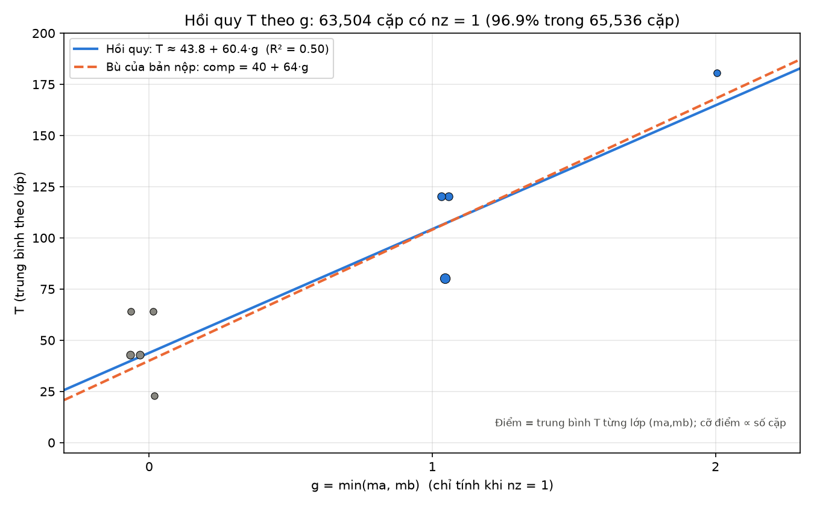

*Hình 6. Hồi quy $T$ theo $g$ trên 63,504 cặp có $nz = 1$. Điểm là trung bình $T$ từng lớp. Đường liền là hồi quy, đường đứt là bù của bản nộp.*

**Lý do tạo hình này:**
1. **Trả lời câu hỏi "vì sao 40 và 64":** bản nộp dùng $comp = 64g + 40nz$. Hình cho thấy bù này là một đường thẳng theo $g$, đi sát $T$ trung bình. Đây là bằng chứng thống kê cho việc chọn hằng (mục 3.5).
2. **Thể hiện giới hạn một cách trung thực:** $R^2 = 0.50$ cho thấy $g$ chỉ giải thích một nửa phương sai. Hình đưa con số này lên đầu để không bị hỏi bất ngờ khi thuyết trình.
3. **Dùng trung bình theo lớp thay vì từng cặp:** 63,504 điểm sẽ chồng lên nhau. Trung bình theo 9 lớp cho hình đọc được, và đường hồi quy vẫn được tính trên toàn bộ cặp.
4. **Chỉ dùng $nz = 1$:** khi $nz = 0$ thì $comp = T = 0$ nên không phải phần cần giải thích bằng hồi quy.

**Tái lập:** chạy từ thư mục gốc dự án:

```bash
python scratch/fig06_regression_T_vs_g.py
```

Script nằm tại `scratch/fig06_regression_T_vs_g.py`, lưu hình vào `docs/figures/fig06_regression_T_vs_g.png`, và in ra `n`, hệ số và $R^2$ để đối chiếu với bảng bên dưới.

---

## 12. Cây nén: ILP hay Dadda (trả lời "cộng bằng gì")

**Ngắn gọn:** bài nộp **không** dùng Dadda cho cây nén. Bài nộp dùng **cây ILP 6 tầng**, sắp bit theo thời điểm đến: 29 FA, 0 HA. Dadda là mốc so sánh.

**Ba khối cần phân biệt:**
1. **Cây nén** (FA và HA gom bit xuống còn 2 hàng): ILP 6 tầng.
2. **Bộ cộng cuối** (cộng 2 hàng thành kết quả 16 bit): bộ cộng mặc định của Yosys. Các bộ cộng prefix (Kogge-Stone, Sklansky, Brent-Kung) đã thử và không cải thiện.
3. **Mốc so sánh**: candidate2 (bài bán kết) dùng Dadda viết tay 5 tầng.

**Dadda** là thuật toán cổ điển. Nó giảm chiều cao từng cột theo dãy 2, 3, 4, 6, 9, … Dadda ưu tiên số tầng ít, không tối ưu số bộ cộng.

**ILP** giải bằng PuLP và HiGHS:
- Mục tiêu: $\min \sum (1.0\,f_{s,c} + 0.6\,h_{s,c})$.
- Ràng buộc: $3f + 2h \le H$, $H_{s+1,c} = H_{s,c} - 2f_{s,c} - h_{s,c} + (f_{s,c-1} + h_{s,c-1})$, và $H_{S,c} \le 2$.
- Nghĩa là ILP tối thiểu số ô dưới ràng buộc số tầng, còn Dadda tối thiểu số tầng bằng quy tắc tham lam.

**Kết quả đo** (cùng ma trận bit của candidate2, ngày 10/11):

| Cây nén | FA | HA | Diện tích (µm²) | Delay (ns) |
|---|---:|---:|---:|---:|
| Dadda tham lam | 27 | 4 | 2805.5 | 1.6189 |
| ILP tối thiểu số ô | 27 | 2 | 2754.7 | 1.5374 |
| candidate2 viết tay (Dadda 5 tầng) | — | — | 2745.4 | 1.5064 |

**Kết luận:** ILP riêng lẻ không vượt candidate2. Diện tích của candidate2 đã gần tối ưu về số ô.

**Phần cải tiến thật** nằm ở ràng buộc số tầng và thứ tự theo thời điểm đến:
- Bản 6 tầng sắp bit theo thời điểm đến, đưa bit bù đến muộn vào chân $z$ của FA.
- Delay giảm từ 1.5375 ns xuống 1.4841 ns (−3.5%). So với bản 5 tầng 1.5058 ns, giảm 1.4%.
- Diện tích và công suất gần như không đổi.
- Đây là cải tiến nhỏ, không nên gọi là đột phá. Mức dưới 2% nằm trong dao động của ABC.

**Số liệu bản nộp:** 29 FA, 0 HA, diện tích convolution_unit 2889.824 µm², delay 1.4841 ns, công suất 0.328 mW.

**Gợi ý câu trên slide:** "Cây nén ILP 6 tầng với thứ tự theo thời điểm đến: delay giảm 3.5% so với cùng cấu trúc không sắp thứ tự, diện tích tương đương candidate2."

**Câu hỏi có thể gặp:**
- *Vì sao không dùng Dadda?* Dadda tối ưu số tầng. ILP tối ưu số ô dưới ràng buộc số tầng. Trên ma trận candidate2, ILP cho ít ô hơn Dadda tham lam (27 FA + 2 HA so với 27 FA + 4 HA). Chưa có số Dadda cho ma trận của bản nộp.
- *ILP có tốt hơn candidate2 không?* Không đáng kể. Ở biến thể ILP của candidate2, 4 tầng cho diện tích −0.36%, 5 tầng cho diện tích +0.06% (DECISIONS, mục ILP có ràng buộc số tầng).
- *Vậy cải tiến là gì?* Thứ tự theo thời điểm đến, đưa bit bù đến muộn vào chân nhanh hơn của FA. Lợi ích đo được là delay giảm khoảng 3.5% so với bản không sắp thứ tự.

**Nguồn:** §6 của tài liệu, DECISIONS (mục thử nghiệm cây nén ILP, `scratch/gen_tree_rtl.py`; mục ILP có ràng buộc số tầng, `scratch/stage_ilp_tree.py`; DEC-052).

---

## 13. ILP giải thích để kiểm tra slide

Mục này dùng để đối chiếu slide với ý nghĩa thật. Mọi số ở đây đã được chạy lại bằng `scratch/hwmaj_ilp.py` (cùng mô hình) và đối chiếu với RTL.

**13.1. Đầu vào: ma trận bit của bản nộp, 50 bit**

- 43 tích riêng phần với $i + j \ge 6$.
- 5 bit bù: $nz$ ở cột 3 và cột 5; $g$ ở cột 6, 7, 8.
- 2 hằng Baugh-Wooley ở cột 8 và cột 15.

Chiều cao từng cột, từ cột 3 đến cột 15: 1, 1, 8, 9, 9, 6, 5, 4, 3, 2, 1, 1 (cột 4, 0, 1, 2 bằng 0 hoặc không có bit). Tổng: 50 bit.

**13.2. Biến quyết định**

Với mỗi tầng $s$ và cột $c$:
- $f_{s,c}$: số FA dùng ở đó.
- $h_{s,c}$: số HA dùng ở đó.
- $H_{s,c}$: chiều cao cột $c$ trước tầng $s$.

Các biến đều là số nguyên không âm. Solver không chọn vị trí của từng bit, chỉ chọn số lượng bộ cộng ở mỗi cột, mỗi tầng.

**13.3. Ràng buộc và hàm mục tiêu**

$$
3 f_{s,c} + 2 h_{s,c} \le H_{s,c}
$$

Không dùng nhiều bit hơn số bit đang có.

$$
H_{s+1,c} = H_{s,c} - 2 f_{s,c} - h_{s,c} + \big(f_{s,c-1} + h_{s,c-1}\big)
$$

Chiều cao cột sau tầng: FA rút 3 bit thành 1 (giảm 2), HA rút 2 thành 1 (giảm 1), và bit nhớ từ cột bên phải (cột $c-1$ theo chỉ số mã nguồn) được cộng vào.

$$
H_{6,c} \le 2
$$

Sau 6 tầng mỗi cột còn tối đa 2 bit, để bộ cộng cuối cộng hai hàng.

$$
\min \sum_{s,c} \big(1.0\,f_{s,c} + 0.6\,h_{s,c}\big)
$$

Mục tiêu: tổng chi phí diện tích ước lượng nhỏ nhất (FA = 1.0, HA = 0.6).

**13.4. Solver làm việc thế nào**

- PuLP tạo mô hình, HiGHS giải.
- Bước 1: nới lỏng số nguyên thành số thập phân, giải bằng phương pháp đơn hình. Cho một cận dưới của chi phí.
- Bước 2: nếu nghiệm chưa nguyên, chia thành hai nhánh (ví dụ $f \le k$ và $f \ge k+1$) và lặp lại. Nhánh không thể tốt hơn nghiệm đã có thì bỏ.
- Kết thúc khi trạng thái là `Optimal`. Với mô hình này, trạng thái là Optimal và chi phí là 29.0.

**13.5. Kiểm tay ở tầng 1**

Các giá trị solver cho tầng 1: cột 6 có $f = 0$; cột 7 có $f = 2$; cột 8 có $f = 1$; cột 9 có $f = 0$.

- Cột 7: $H_{0,7} = 9$, nhớ từ cột 6 là 0, $H_{1,7} = 9 - 4 - 0 + 0 = 5$.
- Cột 8: $H_{0,8} = 9$, nhớ từ cột 7 là 2, $H_{1,8} = 9 - 2 - 0 + 2 = 9$.
- Cột 9: $H_{0,9} = 6$, nhớ từ cột 8 là 1, $H_{1,9} = 6 - 0 - 0 + 1 = 7$.

Các giá trị này khớp đầu ra của solver.

**13.6. Lời giải**

Số FA theo tầng: 6, 9, 4, 4, 3, 3 (tổng 29), 0 HA. Khớp bảng §6.2 của tài liệu.

| Tầng | FA ở các cột (cột: số lượng) | Chiều cao tối đa sau tầng |
|:---:|---|:---:|
| 1 | 7:2, 8:1, 10:1, 11:1, 12:1 | 9 |
| 2 | 6:1, 8:3, 9:2, 10:1, 11:1, 13:1 | 6 |
| 3 | 8:1, 9:2, 10:1 | 6 |
| 4 | 7:2, 9:1, 11:1 | 6 |
| 5 | 6:2, 8:1 | 4 |
| 6 | 7:1, 10:1, 12:1 | 2 |

**13.7. Đối chiếu với RTL**

RTL `asic/rtl/hwmaj_ilp6t_asic.v` được sinh từ lời giải này (`scratch/tree_timing.py`, cấu hình `tt_s6_arr`). Đã kiểm theo thứ tự tên wire: tầng 1 gồm `s1, s2` ở cột 7, `s3` ở cột 8, `s4` ở cột 10, `s5` ở cột 11, `s6` ở cột 12, khớp bảng trên.

**13.8. Những gì slide có thể nói và những gì không nên nói**

Có thể nói:
- ILP chọn số FA và HA cho từng cột, từng tầng, dưới ràng buộc chiều cao. Mô hình có 6 tầng × 16 cột biến nguyên.
- Lời giải tối ưu của mô hình này có 29 FA, 0 HA, đã được solver xác nhận.
- Lịch tầng và số bộ cộng theo cột khớp RTL.
- Thứ tự theo thời điểm đến dùng giả định trễ (tích = 1, bit bù = 3.5). Đây là ước lượng.

Không nên nói:
- "ILP là kỹ thuật mới về toán": ILP đã có từ lâu, điều mới là áp dụng cho cây nén của bản nộp.
- "ILP tốt hơn Dadda X%" cho bản nộp: chưa có số Dadda cho ma trận này. Số đo duy nhất là trên candidate2 (27 FA + 2 HA so với 27 FA + 4 HA; diện tích 2754.7 so với 2805.5 µm²).
- "Cây có đúng 6 tầng về độ sâu logic": 6 là số tầng của lịch ILP, không phải độ sâu đo bằng STA.
- "Delay giảm 3.5% do ILP": phần giảm 3.5% là do sắp theo thời điểm đến so với cùng cấu trúc không sắp; ILP đưa ra số bộ cộng.

---

## 14. Hình minh họa cho từng bước giải thích ILP

Mỗi bước trong phần giải thích ILP (mục 13) có một hình tương ứng. Các hình được sinh bởi `scratch/draw_ilp6t_steps.py` và `scratch/draw_ilp6t_explain.py`.

| Bước | Nội dung | Hình |
|:---:|---|---|
| 1 | Ma trận bit: 50 bit, chiều cao từng cột | Hình 7, ảnh "Ban đầu" (`fig07_ilp6t_stages.png`) |
| 2 | Biến $f_{s,c}$, $h_{s,c}$: mỗi tầng, mỗi cột một số nguyên | Hình 10, bên trái (`fig10_ilp_variables.png`) |
| 3 | Ràng buộc: không quá số bit có; công thức chiều cao có nhớ | Hình 8, kiểm tay cột 7 đến 10 ở tầng 1 (`fig08_ilp6t_column_check.png`) |
| 4 | Mục tiêu: $\min \sum (1.0\,f + 0.6\,h)$ | Ghi chú trong Hình 10 và Hình 11 (chi phí 29.0) |
| 5 | Solver: nới lỏng rồi ép về số nguyên | Hình 10, bên phải: 17 giá trị thập phân ở nghiệm LP. Hình 9 là ví dụ minh họa 2 biến (`fig09_ilp_region_example.png`) |
| 6 | Vì sao 29 là tối ưu | Hình 11 (`fig11_ilp_bound.png`): cận dưới LP = 29.0 = nghiệm nguyên |
| 7 | Tóm tắt: lời giải cuối cùng | Hình 7, toàn bộ 7 ảnh (29 FA, 0 HA) |

**Số liệu kiểm trong các hình:**
- Nghiệm nguyên: 29 FA, 0 HA, chi phí 29.00.
- Nghiệm nới lỏng (LP): chi phí 29.00, 17 giá trị thập phân, ví dụ $f_{0,6} = 2.67$ và $f_{0,11} = 1.33$.
- Kiểm tay cột 7, 8, 9, 10 ở tầng 1 khớp đầu ra solver: 5, 9, 7, 3.

**Lưu ý khi trình bày:**
- Hình 9 là ví dụ một cột 5 bit để minh họa cơ chế, không phải số liệu của bản nộp. Cần nói rõ điều này khi chiếu.
- Hình 9 có một đoạn màu cam nằm trên trục hoành, đó là biên $h \ge 0$ chứ không phải ràng buộc $2f + h \ge 3$.

---

## 15. Nhóm bit của từng FA qua 6 tầng (lấy từ RTL)

Các hình `fig12_stage1_groups.png` đến `fig17_stage6_groups.png` khoanh đỏ ba bit gom thành một FA ở mỗi tầng. Nhãn trên khoanh là tên wire trong `asic/rtl/hwmaj_ilp6t_asic.v`. Không có HA nào, vì lời giải ILP có 0 HA. Script: `scratch/draw_ilp6t_groups.py`. Script đọc trực tiếp RTL, và kiểm tra: số FA mỗi tầng là 6, 9, 4, 4, 3, 3; mọi đầu vào của FA đã sẵn sàng ở tầng của nó; không bit nào được dùng hai lần.

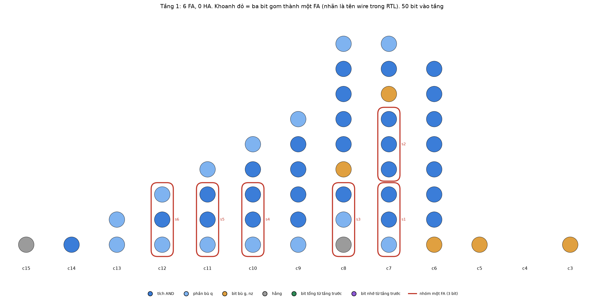

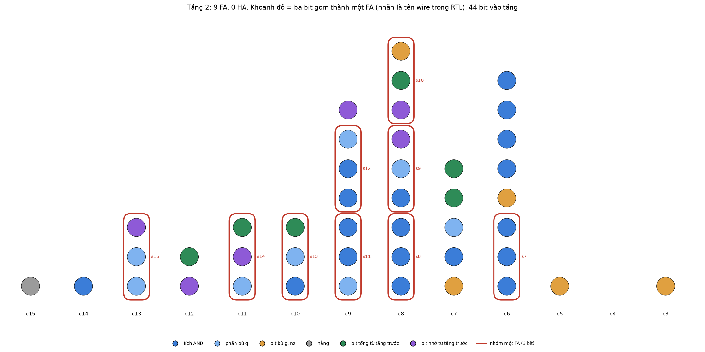

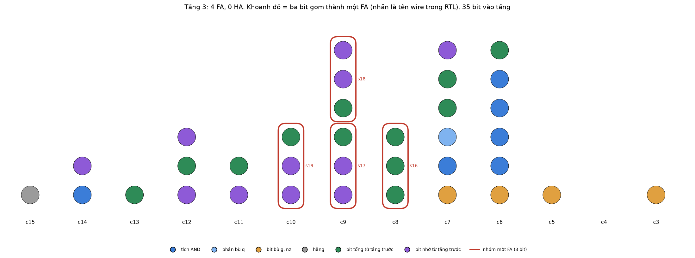

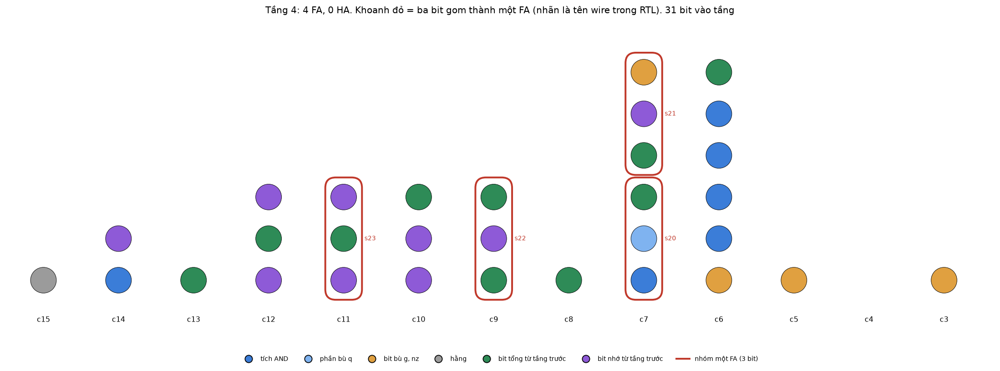

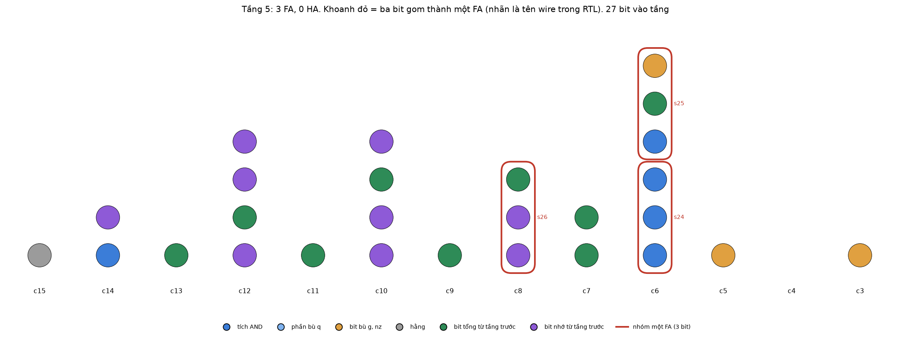

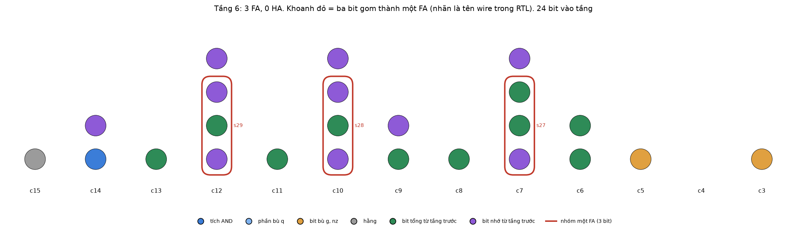

| Tầng | FA (tên wire @ cột) | Đầu vào |
|:---:|---|---|
| 1 | s1@7, s2@7, s3@8, s4@10, s5@11, s6@12 | toàn bit thô (s3 dùng hằng `1'b1`) |
| 2 | s7@6, s8@8, s9@8, s10@8, s11@9, s12@9, s13@10, s14@11, s15@13 | bit thô, tổng và nhớ của tầng 1, `comp[8]` |
| 3 | s16@8, s17@9, s18@9, s19@10 | tổng và nhớ của tầng 2 |
| 4 | s20@7, s21@7, s22@9, s23@11 | `s1`, `s2`, `k7`, `comp[7]`, tổng và nhớ tầng 3 |
| 5 | s24@6, s25@6, s26@8 | bit thô cột 6, `s7`, `comp[6]`, `k20`, `k21`, `s16` |
| 6 | s27@7, s28@10, s29@12 | tổng và nhớ của các tầng trước |

**Điểm cần nhớ khi trình bày:**
- Bit thô có thể chờ nhiều tầng mới được ghép, ví dụ `s24` ghép ba tích thô của cột 6 ở tầng 5. Lịch ILP quy định số FA mỗi cột mỗi tầng, không quy định bit nào đi sớm nhất.
- Bit bù `comp[6]`, `comp[7]`, `comp[8]` đi vào chân $z$ của `s25`, `s21`, `s10`. `comp[3]` và `comp[5]` không vào FA nào, đi thẳng vào bộ cộng cuối.

---

## 16. Vì sao ILP chọn toàn FA, đúng 29 bộ, và lịch theo tầng

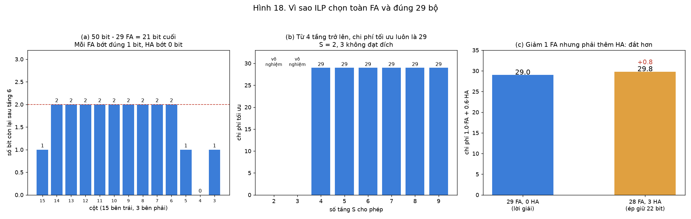

*Hình 18. (a) đếm bit; (b) chi phí tối ưu theo số tầng; (c) giữ thêm 1 bit cuối bằng cách thêm HA thì đắt hơn.* Script: `scratch/draw_ilp6t_reason.py`.

**1. Đếm bit.** Một FA lấy 3 bit, trả 1 bit tổng ở cùng cột và 1 bit nhớ ở cột kế: tổng số bit giảm đúng 1. Một HA lấy 2 bit, trả 2 bit: tổng số bit không đổi, HA chỉ dời một bit sang cột kế. Vậy nếu không có HA thì $\#FA = 50 - (\text{số bit cuối})$.

**2. Vì sao 29.** Số bit cuối của lời giải là 21: cột 3 có 1, cột 4 có 0, cột 5 có 1, cột 6 đến 14 mỗi cột 2 (tổng 18), cột 15 có 1. Do đó $\#FA = 50 - 21 = 29$.

**3. Vì sao không dùng HA.** Giữ thêm 1 bit cuối (22 bit) cần 28 FA nhưng phải thêm 3 HA, chi phí $28 + 3 \times 0.6 = 29.8 > 29$ (đã giải lại bằng solver, cùng kết quả cho S = 6 và S = 9). HA không làm giảm số bit nên chỉ đáng dùng khi nó rẻ hơn FA thay thế, và ở đây thì không.

**4. Vì sao 6 tầng, và vì sao lịch như vậy.**
- Số tầng không quyết định chi phí. Với S từ 4 đến 9, chi phí tối ưu đều là 29 (29 FA, 0 HA). S = 2 và S = 3 không đạt đích. Lý do: cột cao 9 phải xuống 2 bit, và mỗi tầng một cột cao $H$ chỉ dùng được tối đa $\lfloor H/3 \rfloor$ FA (ràng buộc $3f \le H$), nên cần ít nhất 4 tầng.
- Nghĩa là nghiệm 6 tầng không phải duy nhất. Một nghiệm 4 tầng cộng thêm 2 tầng rỗng cũng đạt 29. Cách chia 6, 9, 4, 4, 3, 3 là một nghiệm tối ưu do solver chọn.
- Lựa chọn 6 tầng đến từ thí nghiệm thời gian (DEC-051, DEC-052: thử S = 5, 6, 7, thứ tự gốc và thứ tự theo thời điểm đến), không đến từ ILP. Phần cải thiện delay là khoảng 1.4%, nằm trong dao động của ABC.

**Không nên nói trên slide:** "ILP chọn 6 tầng" hoặc "6, 9, 4, 4, 3, 3 là cách chia duy nhất tối ưu".

---

## 17. Hình trình bày cách solver giải (dùng cho slide)

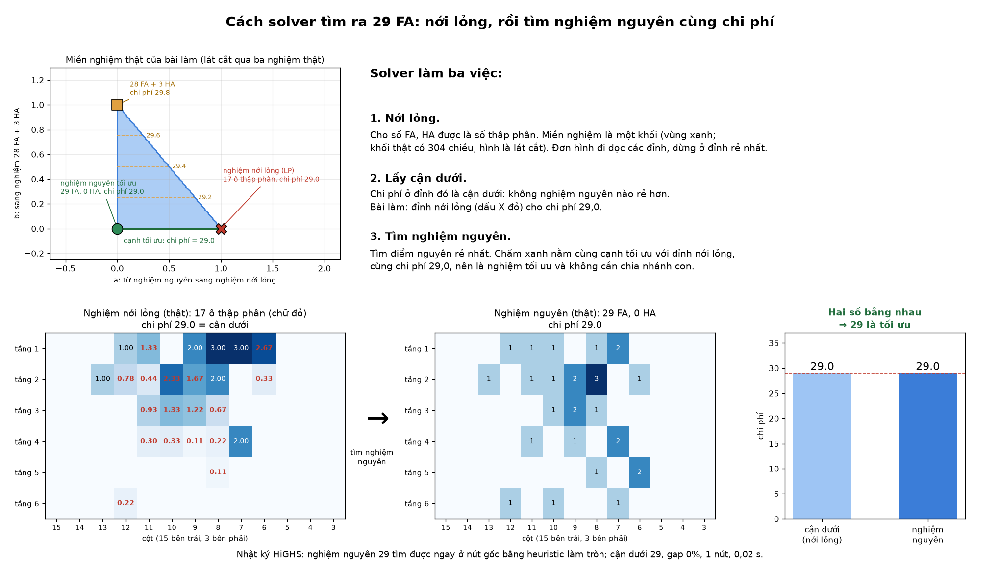

*Hình 21. Nới lỏng rồi tìm nghiệm nguyên cùng chi phí.* Script: `scratch/draw_ilp6t_solver_slide.py`. Hình 19 và 20 (`scratch/draw_ilp6t_solve.py`, `scratch/draw_ilp6t_solver_detail.py`) là bản chi tiết theo nhật ký HiGHS, dùng làm dự phòng khi bị hỏi.

**Hình gồm bốn phần:**
1. **Ý tưởng trên ví dụ nhỏ 2 biến** (minh họa, không phải số bài thật): vùng xanh là miền nới lỏng; đỉnh LP $(1.5;\,0)$ cho chi phí 1.5, không nguyên; điểm nguyên $(1;\,1)$ cho 1.6.
2. **Nghiệm nới lỏng thật của bản nộp:** 17 ô $f_{s,c}$ có giá trị thập phân (chữ đỏ), chi phí 29.0, là cận dưới.
3. **Nghiệm nguyên thật:** 29 FA, 0 HA, chi phí 29.0.
4. **So sánh:** cận dưới 29.0 bằng nghiệm nguyên 29.0, nên 29 là tối ưu.

**Điều khác nhau giữa ví dụ nhỏ và bài thật (cần nói rõ):** ở ví dụ nhỏ cận dưới (1.5) khác nghiệm nguyên (1.6), nên solver phải làm thêm bước chứng minh. Ở bài thật hai số trùng nhau (29.0), nên không cần chia nhánh con.

**Số liệu kiểm:** LP 29.00 với 17 ô thập phân; nghiệm nguyên 29.00; nhật ký HiGHS: nghiệm 29 tìm được ở nút gốc bằng heuristic, gap 0%, 1 nút, 0.02 s.

**Cập nhật:** phần "ý tưởng hình học" của Hình 21 đã được thay bằng miền nghiệm thật của bài làm (Hình 22), không còn dùng ví dụ nhỏ.

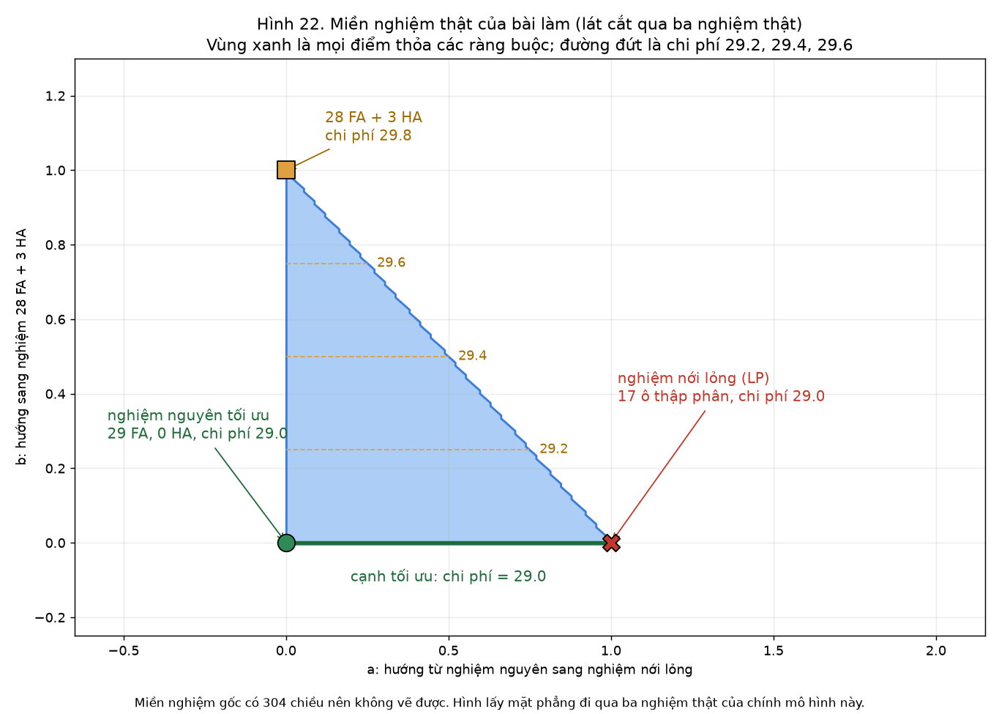

*Hình 22. Miền nghiệm thật của bài làm, lát cắt qua ba nghiệm thật.* Scripts: `scratch/ilp6t_slice.py`, `scratch/draw_ilp6t_region.py`.

### Hình đơn giản thay cho Hình 22 khi trình bày

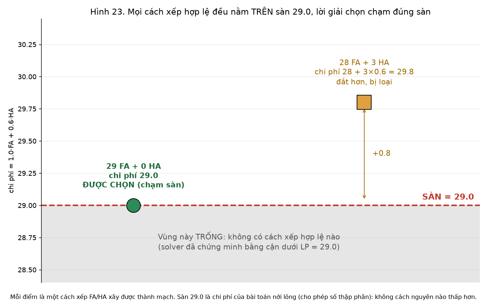

*Hình 23. Mọi cách xếp hợp lệ nằm trên sàn 29.0; lời giải chọn chạm đúng sàn.* Script: `scratch/draw_ilp6t_simple_floor.py`. Chỉ dùng ba số đã có ở trên: cận dưới LP = 29.0, 29 FA + 0 HA = 29.0, 28 FA + 3 HA = 29.8. Hình này là minh họa, không liệt kê hết các cách xếp hợp lệ; phần chứng minh vẫn là cận dưới LP bằng nghiệm nguyên (Hình 11).

**Cách dựng hình:** miền nghiệm gốc nằm trong không gian 304 chiều nên không vẽ trực tiếp được. Hình lấy mặt phẳng đi qua ba nghiệm thật của chính mô hình:
- $X_{INT}$: nghiệm nguyên tối ưu (29 FA, 0 HA, chi phí 29.0);
- $X_{LP}$: nghiệm của bài toán nới lỏng (chi phí 29.0, 17 ô thập phân);
- $X_{ALT}$: nghiệm nguyên khi ép giữ 22 bit cuối (28 FA + 3 HA, chi phí 29.8).

Điểm trên mặt phẳng là $x = (1-a-b)\,X_{INT} + a\,X_{LP} + b\,X_{ALT}$. Các ràng buộc đẳng thức luôn thỏa, nên chỉ cần kiểm các bất đẳng thức $x \ge 0$, $3f + 2h \le H$, $H_{6,c} \le 2$ trên lưới điểm. Chi phí trên mặt phẳng là $29 + 0.8\,b$.

**Điều hình cho thấy:**
- Vùng thỏa ràng buộc trong mặt phẳng này là một tam giác có ba đỉnh là ba nghiệm thật.
- Cạnh dưới ($b = 0$) có chi phí đúng 29.0. Cả nghiệm nguyên lẫn nghiệm nới lỏng nằm trên cạnh này, nên cận dưới và nghiệm nguyên trùng nhau.
- Chi phí tăng dần khi đi lên đỉnh $X_{ALT}$ (29.2, 29.4, 29.6, 29.8).

**Cần nói rõ khi trình bày:** đây là một lát cắt hai chiều của miền nghiệm, không phải toàn bộ miền 304 chiều. Cạnh tối ưu chứa hai điểm trong lát cắt này, nhưng không cho biết nó có bao nhiêu nghiệm nguyên khác.

**Hình:** `docs/figures/fig06_regression_T_vs_g.png`. Hình gồm các điểm là trung bình $T$ của từng lớp $(m_a, m_b)$, đường hồi quy liền, và đường bù $comp = 40 + 64g$ đứt. Hình đã được kiểm lại.

**Số liệu** (tính bằng Python trên 65,536 cặp $(a,b)$, lấy các cặp có $nz = 1$):

| Chỉ số | Giá trị |
|---|---|
| Số cặp có $nz = 1$ | 63,504 (96.9%) |
| Hồi quy $T$ theo $g$ | $T \approx 43.83 + 60.44\,g$ |
| $R^2$ | **0.50** |
| $T$ trung bình khi $g = 0$ | 46.3 (độ lệch chuẩn 27.5; 26,640 cặp) |
| $T$ trung bình khi $g = 1$ | 100.3 (độ lệch chuẩn 40.4; 32,768 cặp) |
| $T$ trung bình khi $g = 2$ | 180.6 (độ lệch chuẩn 39.0; 4,096 cặp) |
| Sai số trung bình của $comp = 40 + 64g$ trên các cặp $nz = 1$ | −1.54 |

**Điểm cần nói rõ khi trình bày:**
- $R^2 = 0.50$: $g$ giải thích khoảng một nửa phương sai của $T$. Nửa còn lại là phần sai số dư, không thể bắt bằng 9 lớp. Đây là lý do bù không hoàn hảo, và nên nói thẳng trên slide thay vì che đi.
- Hai đường gần như chồng nhau: hồi quy là $43.8 + 60.4g$, bù của bản nộp là $40 + 64g$. Khác biệt chủ yếu ở hệ số chặn, nên bản nộp chọn các số tròn và khớp phần cứng.
- Hình đặt trung bình theo lớp, không đặt từng cặp, vì 63,504 điểm sẽ chồng lên nhau.

**Gợi ý tiêu đề slide:** "Bù tuyến tính theo $g$ khớp $T$ trung bình, giải thích được 50% phương sai."
