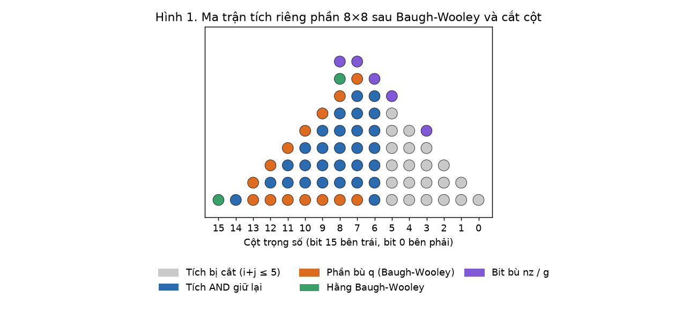
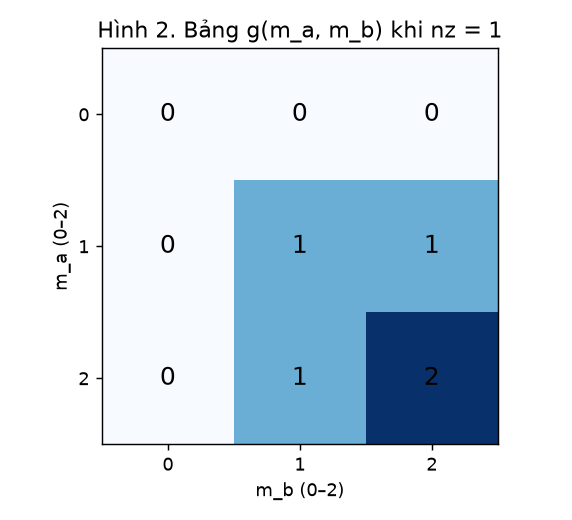
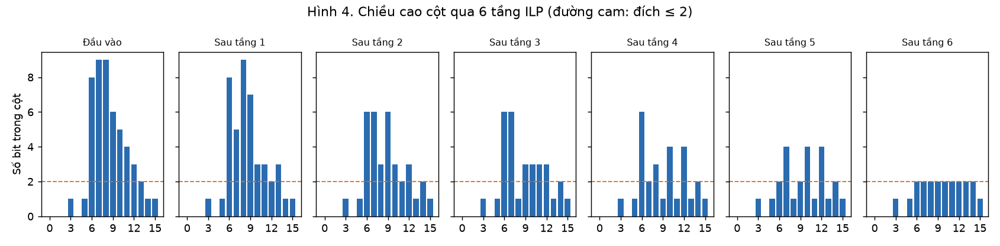
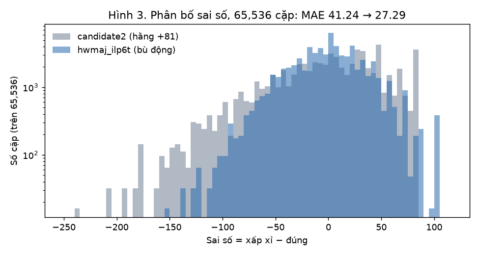
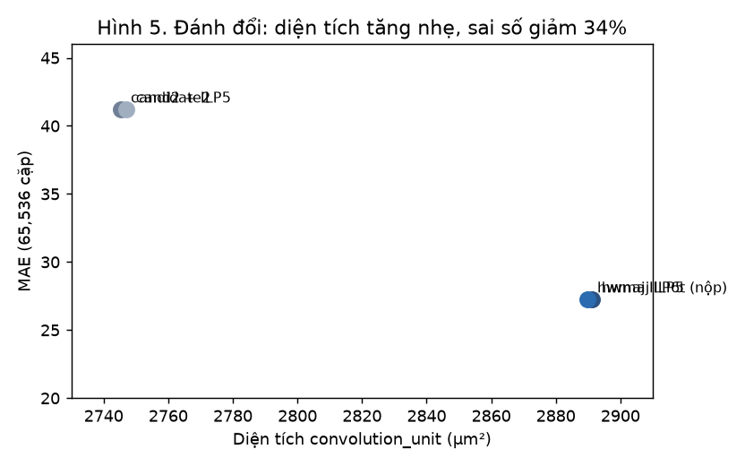

# Giải thích kỹ thuật bộ nhân `hwmaj_ilp6t_asic`

**Ngày:** 2026-11-10 · **RTL:** `asic/rtl/hwmaj_ilp6t_asic.v` · **Hàm tương đương:** `hw_maj_s64` (khớp 65,536/65,536)

Tài liệu đi từ nền tảng đến kỹ thuật riêng. Mỗi phần có công thức, ví dụ tính tay từ dữ liệu thật, và ghi rõ phần nào là kế thừa, phần nào là điểm khác.

---

## 0. Bối cảnh bài toán

- **Mục tiêu:** nhân hai số có dấu INT8 (`a`, `b` ∈ [−128, 127]) cho bộ tăng tốc CNN, cho kết quả 16-bit.
- **Ràng buộc:** không huấn luyện lại mạng. Trọng số cố định, nên sai số của bộ nhân ảnh hưởng trực tiếp đến độ chính xác.
- **Thang điểm BTC:** 30% kiến trúc (độ trễ, diện tích, cổng, công suất), 30% tích hợp CNN, 20% độ chính xác, 20% báo cáo và bảo vệ.
- **Luồng đo:** Yosys (tổng hợp, thư viện Nangate 45nm) và OpenSTA (ràng buộc `constraints.sdc`: chu kỳ 10 ns, trễ vào/ra 2 ns, tải 0.05 pF). Độ trễ = thời điểm đến dữ liệu − 2.0 ns.
- **Đo CNN:** 1000 ảnh MNIST, mạng conv 3×3 với 4 kernel, rồi dense 324 → 10. Mọi phép nhân trong conv dùng bộ nhân xấp xỉ.

Một điểm quan trọng: bộ nhân trong conv nhận **pixel thô** (0–127, khoảng 82% bằng 0 trong 200 ảnh đầu) nhân với **trọng số** (−127…23 trong kernel). Lớp dense nhận đầu vào sau ReLU và max-pooling.

---

## 1. Nhân có dấu và ma trận tích riêng phần

Biểu diễn bù hai 8 bit: `a = −a₇·2⁷ + Σᵢ₌₀⁶ aᵢ·2ⁱ`. Ví dụ `−51` có bit `11001101`, vì `256 − 51 = 205`. Kiểm: `−128 + (64 + 8 + 4 + 1) = −51`.

Nhân thường (không dấu) tạo 64 tích riêng phần `aᵢ·bⱼ` tại cột `i + j`. Với 8×8, cột `c` có `min(c+1, 15−c)` tích. Tổng các tích có trọng số cho ra `a·b`.

Với số có dấu, bit dấu có trọng số âm, nên không thể cộng thẳng. Đó là lý do cần Baugh-Wooley (phần 2).

---

## 2. Baugh-Wooley: đổi dấu bằng phần bù q(x,y) = 1 − xy (chứng minh từng bước)

Ký hiệu: `a = (a₇…a₀)` và `b = (b₇…b₀)` là hai số bù hai 8 bit, `aᵢ`, `bⱼ` ∈ {0,1}.

### Bước 1: trọng số của từng bit

Trong bù hai 8 bit, bit `i < 7` có trọng số `wᵢ = 2ⁱ`, còn bit dấu có trọng số `w₇ = −2⁷`. Vậy

```
a = Σᵢ₌₀⁷ wᵢ·aᵢ,        b = Σⱼ₌₀⁷ wⱼ·bⱼ          (1)
```

Ví dụ `−51 = 11001101₂`: `−128 + 64 + 8 + 4 + 1 = −51`.

### Bước 2: khai triển tích

Nhân hai tổng (1):

```
a·b = Σᵢ Σⱼ wᵢ·wⱼ·aᵢ·bⱼ          (2)
```

Chia các số hạng thành 4 nhóm theo `(i, j)`:

| Nhóm | `wᵢ·wⱼ` | Số hạng trong (2) | Dấu |
|:---|:---|:---|:---|
| `i < 7`, `j < 7` | `2^(i+j) > 0` | `aᵢbⱼ·2^(i+j)` | dương |
| `i = 7`, `j < 7` | `−2^(7+j)` | `−a₇bⱼ·2^(7+j)` | **âm** |
| `i < 7`, `j = 7` | `−2^(7+i)` | `−aᵢb₇·2^(7+i)` | **âm** |
| `i = j = 7` | `(−2⁷)² = 2¹⁴` | `a₇b₇·2¹⁴` | dương |

Vấn đề: 14 số hạng âm (nhóm 2 và 3) không thể đưa thẳng vào cây cộng dương. Baugh-Wooley xử lý chúng ở bước 3.

### Bước 3: đổi số hạng âm thành phần bù q

Với `x, y ∈ {0,1}`, đặt `q(x,y) = 1 − xy`. Khi đó

```
−xy = (1 − xy) − 1 = q(x,y) − 1
```

Kiểm tra: nếu `xy = 0` thì `0 = (1 − 0) − 1` ✓; nếu `xy = 1` thì `−1 = (1 − 1) − 1` ✓.

Áp dụng cho số hạng nhóm 2 và nhóm 3, nhân thêm `2^k`:

```
−a₇bⱼ·2^(7+j) = q(a₇, bⱼ)·2^(7+j) − 2^(7+j)          (3)
−aᵢb₇·2^(7+i) = q(aᵢ, b₇)·2^(7+i) − 2^(7+i)          (4)
```

Bây giờ mọi số hạng chứa `q` đều dương. Phần còn âm là các hằng `−2^k`.

### Bước 4: gom các hằng

Có 7 hằng từ (3) và 7 hằng từ (4), tổng cộng:

```
C₀ = −Σⱼ₌₀⁶ 2^(7+j) − Σᵢ₌₀⁶ 2^(7+i) = −2 · Σₖ₌₇¹³ 2ᵏ
```

Tổng cấp số nhân: `Σₖ₌₇¹³ 2ᵏ = 2¹⁴ − 2⁷`. Do đó

```
C₀ = −2·(2¹⁴ − 2⁷) = −2¹⁵ + 2⁸          (5)
```

Số hạng `a₇b₇·2¹⁴` không đổi.

### Bước 5: ghép lại thành đẳng thức

Thay (3), (4), (5) vào (2):

```
a·b = Σ_{i<7, j<7} aᵢbⱼ·2^(i+j)  +  Σⱼ₌₀⁶ q(a₇,bⱼ)·2^(7+j)  +  Σᵢ₌₀⁶ q(aᵢ,b₇)·2^(7+i)
      + a₇b₇·2¹⁴  +  (2⁸ − 2¹⁵)          (6)
```

(6) là đẳng thức số nguyên đúng với mọi cặp `(a, b)`, chưa cần lấy mod. Đã kiểm trên đủ 65,536 cặp.

### Bước 6: đưa về 16 bit

Kết quả 16 bit có dấu, nên ta lấy (6) mod 2¹⁶. Vì `2¹⁶ = 2·2¹⁵` nên `−2¹⁵ ≡ 2¹⁵ (mod 2¹⁶)`, do đó

```
2⁸ − 2¹⁵ ≡ 2⁸ + 2¹⁵ = 0x8100  (mod 2¹⁶)
```

Đây là hai bit hằng ở cột 8 và cột 15. Giá trị `a·b` nằm trong [−16256, 16384], vừa khít dải 16 bit có dấu [−32768, 32767], nên biểu diễn mod 2¹⁶ là đúng.

**Kết luận:** ma trận sau Baugh-Wooley chỉ có tích AND (nhóm 1), phần bù q (nhóm 2, 3), một tích AND ở cột 14, và hai bit hằng ở cột 8 và 15. Cộng lại cho `a·b mod 2¹⁶`.

### Bước 7: kiểm tra bằng ví dụ

**Ví dụ A: a = b = −1** (`11111111`, nên `a₇ = b₇ = 1`, các bit còn lại đều bằng 1).

- Nhóm 1: `Σ_{i,j<7} 2^(i+j) = (2⁷ − 1)² = 16129`
- Nhóm 2 và 3: `q(1,1) = 0`, nên đóng góp 0
- `a₇b₇·2¹⁴ = 16384`
- Hằng: `2⁸ − 2¹⁵ = −32512`

Tổng: `16129 + 16384 − 32512 = 1 = (−1)·(−1)` ✓

**Ví dụ B: a = b = −128** (`10000000`, nên `a₇ = b₇ = 1`, các bit khác bằng 0).

- Nhóm 1: 0 (mọi `aᵢ = 0` với `i < 7`)
- Nhóm 2: `q(a₇, bⱼ) = q(1, 0) = 1` với mọi j < 7, tổng `Σⱼ 2^(7+j) = 16256`
- Nhóm 3: tương tự, `16256`
- `a₇b₇·2¹⁴ = 16384`
- Hằng: `−32512`

Tổng: `0 + 16256 + 16256 + 16384 − 32512 = 16384 = (−128)·(−128)` ✓

**Ví dụ C: a = −1, b = 2** (để thấy nhóm 2 đóng góp khác 0 với b₇ = 0).

- Nhóm 1: `a_i = 1` với i < 7 và `b₁ = 1`, các bit b khác 0. Tổng: `Σᵢ<7 2^(i+1) = 2 + 4 + … + 128 = 254`
- Nhóm 2: `q(a₇, bⱼ) = q(1, bⱼ) = 1 − bⱼ`, chỉ j ≠ 1 có giá trị 1. Tổng: `Σ_{j≠1, j<7} 2^(7+j) = (16256) − 256 = 16000`
- Nhóm 3: `q(aᵢ, b₇) = q(aᵢ, 0) = 1` với mọi i < 7. Tổng: `16256`
- `a₇b₇ = 0`
- Hằng: `−32512`

Tổng: `254 + 16000 + 16256 − 32512 = −2 = (−1)·2` ✓

(Các số trong Ví dụ C đã được kiểm bằng Python cùng công thức (6).)



*Hình 1. Ma trận 8×8. Cột 15 bên trái, cột 0 bên phải. Các tích xám (i+j ≤ 5) bị cắt. Cam là phần bù q, xanh dương là tích AND, xanh lá là hằng Baugh-Wooley, tím là bit bù.*

**Kế thừa:** Baugh-Wooley (1973) là kỹ thuật chuẩn. Không phải điểm mới.

---

## 3. Cắt cột 0–5

Các tích có `i + j ≤ 5` nằm ở 6 cột thấp. Có 1+2+3+4+5+6 = **21 tích** bị bỏ. Đây là điểm chung với các bộ nhân "cắt cột" (fixed-width truncation) đã có trong tài liệu.

Gọi `T` là tổng giá trị 21 tích bị bỏ:

```
T = Σ_{i+j ≤ 5} aᵢ·bⱼ·2^(i+j)
```

Không có cắt, `p = a·b`. Có cắt, `p = a·b − T`. Sai số không bù là `−T`, và `T` luôn không âm, nên nếu không bù thì kết quả luôn thấp hơn đúng.

**Chứng minh:** các tích bị cắt có `i + j ≤ 5`, nên không chứa chỉ số 7 và đều là tích AND (không có số hạng q). Số tích là `Σ_{c=0}^{5} (c+1) = 21`. Với bù, `p = a·b − T + comp`, nên sai số là

```
e = p − a·b = comp − T
```

Vì mọi số hạng của `T` không âm, `T ≥ 0`. Khi `comp = 0`, `e = −T ≤ 0`.

**Vì sao cắt 6 cột mà không cắt nhiều hơn?** Cắt thêm cột 6 (7 cột) giảm diện tích 3–8% nhưng làm MAE tăng 35–135% (DEC-048). Cột 6 chứa 7 tích có trọng số lớn, sai số của chúng khó bù bằng bảng nhỏ.

---

## 4. Bù sai số: từ hằng số đến kỳ vọng

**Bước 1: hằng số tĩnh (candidate2).** Thay vì tính `T`, cộng một hằng `C` cố định. Với bit độc lập đều, `E[T] = ¼ · Σ_{s=0}^{5} (s+1)·2^s = ¼ · 321 = 80.25`. Candidate2 dùng `C = +81`, làm tròn lên.

*Chứng minh E[T] = 80.25:* với bit độc lập đều, `E[aᵢbⱼ] = E[aᵢ]·E[bⱼ] = ¼`. Theo tuyến tính của kỳ vọng, `E[T] = ¼ · Σ_{c=0}^{5} (c+1)·2^c = ¼ · (1 + 4 + 12 + 32 + 80 + 192) = ¼ · 321 = 80.25`.

*Lưu ý khi chọn hằng:* lý thuyết gần 80 hơn 81, nhưng đo trên 65,536 cặp cho `C = 81` có ME = +0.12, còn `C = 80` có ME = −0.87 (`cand2_sweep_c80_k6`). Bản nộp chọn 81 dựa trên đo đạc, không dựa trên lý thuyết.

Kết quả đo trên 65,536 cặp đều: MAE 41.24, ME +0.12, sai số trong khoảng [−240, +81]. Kiểm tra dấu: sai số = xấp xỉ − đúng, nên giá trị âm lớn nhất (−240) xảy ra khi `T` lớn.

**Bước 2: kỳ vọng theo bit.** Khi các bit ngẫu nhiên độc lập với xác suất ½, kỳ vọng của `T` theo `a` là:

```
E[T | a] = ½ · Σᵢ aᵢ·(64 − 2ⁱ)   (i = 0..5)
```

*Chứng minh:* với `a` cố định và `bⱼ` độc lập có `E[bⱼ] = ½`:

```
E[T | a] = ½ · Σ_{i+j≤5} aᵢ·2^(i+j)
         = ½ · Σᵢ aᵢ·2ⁱ · Σ_{j=0}^{5−i} 2ʲ
         = ½ · Σᵢ aᵢ·2ⁱ·(2^(6−i) − 1)
         = ½ · Σᵢ aᵢ·(64 − 2ⁱ)
```

Đã kiểm trên toàn bộ 256 giá trị của `a`.

Suy ra các bit thấp của `a` có ảnh hưởng gần như ngang nhau tới `T`: hệ số `(64 − 2ⁱ)/2` là 31.5, 31, 30, 28, 24, 16 với i = 0..5. Bit `a₀` có hệ số lớn nhất và `a₅` nhỏ nhất. Hằng số tĩnh bỏ qua hoàn toàn thông tin này.

**Vì sao chưa đủ?** Trên các cặp (pixel, trọng số) thật, và với cấu hình cắt 7 cột (không phải cấu hình đang nộp), bù kỳ vọng theo xác suất bit thực tế giảm MAE từ 181 (hằng số 192) xuống 74. Tuy nhiên bảng này gắn chặt với bộ trọng số của cuộc thi nên có nguy cơ quá khớp. Vì vậy bản nộp không dùng nó.

---

## 5. Bù động theo nhóm majority (kỹ thuật chính)

### 5.1. Ý tưởng

Thay vì bảng theo từng trọng số, chia mỗi toán hạng thành hai nhóm 3 bit thấp và đếm "đa số" trong từng nhóm:

```
maj(x, y, z) = xy | xz | yz          (1 nếu ít nhất 2 trong 3 bit bằng 1; là OR logic, KHÔNG phải cộng số học)

ma = maj(a₀,a₁,a₂) + maj(a₃,a₄,a₅)   ∈ {0, 1, 2}
mb = maj(b₀,b₁,b₂) + maj(b₃,b₄,b₅)   ∈ {0, 1, 2}
```

*Chứng minh maj:* với 3 bit, số bit 1 là 0 hoặc 1 thì maj = 0; là 2 hoặc 3 thì maj = 1. Biểu thức `xy | xz | yz` cho đúng các giá trị đó. Không được viết `xy + xz + yz` theo nghĩa cộng: tại (1,1,1) nó bằng 3. `ma` là tổng của hai bit nên nằm trong {0,1,2}, không tràn.

Hai giá trị `ma`, `mb` cho 9 lớp. Một cổng `nz` tắt bù khi một toán hạng có 6 bit thấp bằng 0:

```
nz = (a[5:0] ≠ 0) AND (b[5:0] ≠ 0)
```

*Vì sao nz tắt bù được:* nếu `a[5:0] = 0` thì mọi số hạng cắt `aᵢbⱼ` (có i ≤ 5) đều bằng 0, tức `T = 0`. Khi đó `nz = 0`, `comp = 0`, và sai số `comp − T = 0`. Với `a = 0` hoặc `b = 0`, đầu ra luôn đúng 0. Đã kiểm trên 65,536 cặp: không có vi phạm. Trường hợp `a ≠ 0` nhưng `a[5:0] = 0` (ví dụ `a = 64`) cũng đúng tuyệt đối.

*Giới hạn của nz:* `nz = 1` không đảm bảo `T > 0`. Ví dụ `a = 2`, `b = 32`: tích `a₁b₅` có `1 + 5 = 6 > 5` nên bị loại, do đó `T = 0`. Nhưng `nz = 1`, `m_a = 0`, `g = 0`, `comp = 40`, và sai số là `40`. Cổng `nz` chỉ chặn trường hợp một toán hạng có 6 bit thấp bằng 0, không chặn mọi trường hợp `T = 0`.

Bảng `g(ma, mb)` (chỉ dùng khi `nz = 1`):

| ma \ mb | 0 | 1 | 2 |
|:---:|:---:|:---:|:---:|
| 0 | 0 | 0 | 0 |
| 1 | 0 | **1** | **1** |
| 2 | 0 | **1** | **2** |



*Hình 2. Bảng g(ma, mb) khi nz = 1.*

*Chứng minh g = min(ma, mb):* đối chiếu từng ô của bảng với `min(ma, mb)` trên cả 9 ô, đều khớp. Vì vậy bảng tra tương đương với một phép lấy min. RTL dùng `case` nhưng kết quả giống nhau.

Bù cuối cùng:

```
comp = 64·g + 40·nz      (40 = 2⁵ + 2³, nên nz nằm ở cột 3 và cột 5)
```

Bit `g` nằm ở cột 6 và 7 (`g ≤ 2`, nên `g·64` chỉ cần hai bit). Các bit này lấp vào **chỗ trống** sẵn có của cây nén, nên không cần thêm hàng.

### 5.2. Vì sao chọn majority 3 bit

- **Chi phí thấp:** mỗi `maj3` là 3 cổng AND và 2 cổng OR. Bảng 9 lớp là một hàm 5 đầu vào nhỏ.
- **Đúng hướng:** `E[T]` tăng khi nhiều bit cao của `a` và `b` bằng 1. `ma`, `mb` bắt được xu hướng đó mà không cần đếm đầy đủ.
- **So với các lựa chọn khác (số liệu trong DECISIONS.md, DEC-048):**
  - Nhóm 2 bit (chỉ AND): kém.
  - Leading-one: kém hơn majority.
  - Popcount đầy đủ 7 bit: MAE 15.63, nhưng tốn diện tích.
  - Popcount 4 mức, 16 lớp × hằng 8 bit (cắt 7 cột): diện tích tăng khoảng 28%, không đáng.
  - Bảng minimax trên 5 phân bố: bảng hiện tại đã là nghiệm minimax trong không gian 4⁹ bảng. Giới hạn chính không nằm ở cách chọn bảng mà ở dải `g`.

### 5.3. Ví dụ tính tay (dữ liệu thật)

**Ví dụ 1: pixel 92 × trọng số −51** (pixel 92 là điểm ảnh khác 0 thứ 2 trong ảnh MNIST đầu tiên; −51 là trọng số thứ 2 của kernel 0, sau −1).

- `a = 92` → bit `01011100`
- `b = −51` → bit `11001101`
- Đúng: `a·b = −4692`

Ma trận tích, ký hiệu `*` là tích bị cắt (i+j ≤ 5). Hàng là `aᵢ`, cột là `bⱼ`. Với ô có phần bù, giá trị là `q(aᵢ,bⱼ) = 1 − aᵢ·bⱼ`:

| aᵢ \ bⱼ | b7=1 | b6=1 | b5=0 | b4=0 | b3=1 | b2=1 | b1=0 | b0=1 |
|:---|:---:|:---:|:---:|:---:|:---:|:---:|:---:|:---:|
| a7=0 | 0 | 1 | 1 | 1 | 1 | 1 | 1 | 1 |
| a6=1 | 0 | 1 | 0 | 0 | 1 | 1 | 0 | 1 |
| a5=0 | 1 | 0 | 0 | 0 | 0 | 0 | 0 | 0* |
| a4=1 | 0 | 1 | 0 | 0 | 1 | 1 | 0* | 1* |
| a3=1 | 0 | 1 | 0 | 0 | 1 | 1* | 0* | 1* |
| a2=1 | 0 | 1 | 0 | 0 | 1* | 1* | 0* | 1* |
| a1=0 | 1 | 0 | 0 | 0* | 0* | 0* | 0* | 0* |
| a0=0 | 1 | 0 | 0* | 0* | 0* | 0* | 0* | 0* |

Tính `T` từ các ô `*` có giá trị 1:
- Hàng a4: `a4·b0 · 2⁴ = 16`
- Hàng a3: `a3·b2 · 2⁵ + a3·b0 · 2³ = 32 + 8 = 40`
- Hàng a2: `a2·b3 · 2⁵ + a2·b2 · 2⁴ + a2·b0 · 2² = 32 + 16 + 4 = 52`

Tổng: `T = 16 + 40 + 52 = 108`.

Bù:
- `ma`: maj(a₀,a₁,a₂) = maj(0,0,1) = 0; maj(a₃,a₄,a₅) = maj(1,1,0) = 1 → `ma = 1`
- `mb`: maj(b₀,b₁,b₂) = maj(1,0,1) = 1; maj(b₃,b₄,b₅) = maj(1,0,0) = 0 → `mb = 1`
- `nz = 1` (a[5:0] = 28, b[5:0] = 13, đều khác 0)
- `g(1,1) = 1` → `comp = 64·1 + 40·1 = 104`

Kết quả:

```
p_xấp_xỉ = a·b − T + comp = −4692 − 108 + 104 = −4696
sai số    = comp − T = −4
```

**Ví dụ 2: pixel 64 × trọng số −51.** Pixel 64 có 6 bit thấp bằng 0, nên `nz = 0`. Mọi tích bị cắt có `aᵢ` với i ≤ 5, và đều bằng 0. Vậy `T = 0`, `comp = 0`, và kết quả đúng tuyệt đối `p = −3264`. Đây là lý do của cổng nz: khi `a[5:0] = 0`, không có gì để bù và không có sai số.

**Ví dụ 3: pixel 127 × trọng số −127** (cực đại dương × cực tiểu âm).
- `ma = 2` (maj(1,1,1) + maj(1,1,1) = 1 + 1 = 2)
- `mb = 0` (maj(b₀,b₁,b₂) = maj(1,0,0) = 0; maj(b₃,b₄,b₅) = maj(0,0,0) = 0)
- `nz = 1`, `g(2,0) = 0`, `comp = 40`
- `T = 63`, sai số = `40 − 63 = −23`

Ví dụ này cho thấy bù không hoàn hảo: bảng cho `(2,0)` giá trị `g = 0`, trong khi `T` thực tế là 63. Phần sai số còn lại là cái giá của việc gộp nhiều tổ hợp bit vào 9 lớp.

**Kiểm lại cả ba ví dụ** bằng mô hình (đã chạy): `92 × (−51)` cho p = −4696 (sai số −4); `64 × (−51)` cho p = −3264 (đúng); `127 × (−127)` cho p = −16152 (sai số −23 = 40 − 63).

---

## 6. Cây nén ILP (kỹ thuật thứ hai)

### 6.1. Bài toán

Sau Baugh-Wooley, cắt cột và thêm bit bù, mỗi cột `c` có một số bit `H₀(c)`. Mục tiêu là nén mọi cột xuống còn tối đa 2 bit, sao cho số bộ cộng đầy đủ (FA, trọng số 1.0) và bán cộng (HA, trọng số 0.6) là ít nhất.

Biến quyết định `f_{s,c}` (số FA ở tầng `s`, cột `c`) và `h_{s,c}` (số HA). Chiều cao `H_{s,c}`:

```
Ràng buộc:  3·f_{s,c} + 2·h_{s,c} ≤ H_{s,c}                  (không dùng quá số bit có)
            H_{s+1,c} = H_{s,c} − 2·f_{s,c} − h_{s,c} + (f_{s,c−1} + h_{s,c−1})
            H_{S,c} ≤ 2                                        (đích cuối)
Mục tiêu:   min Σ (1.0·f_{s,c} + 0.6·h_{s,c})
```

**Vì sao các ràng buộc đúng:**
- *Bảo toàn giá trị:* FA lấy 3 bit cùng trọng số `w`, cho bit tổng (trọng số `w`) và bit nhớ (trọng số `2w`): `(x+y+z)·w = (s + 2c)·w`. HA: `(x+y)·w = (s + 2c)·w`. Tổng giá trị mọi bit không đổi qua mỗi tầng, nên cây cuối vẫn cho đúng tổng.
- *Chiều cao:* FA lấy 3 bit ở cột c, trả về 1 bit ở cột c và 1 nhớ sang cột c+1, nên giảm chiều cao cột c đi 2. HA giảm đi 1. Từ đó suy ra công thức `H_{s+1,c}`.
- *`3f + 2h ≤ H`:* không dùng nhiều bit hơn số bit đang có.
- *`H_S ≤ 2`:* sau cây còn tối đa 2 hàng cho bộ cộng cuối.

Giải bằng PuLP với HiGHS. Biến số nguyên, không dương.

### 6.2. Kết quả 6 tầng

| Tầng | FA | HA | Chiều cao tối đa sau tầng |
|:---:|:---:|:---:|:---:|
| 1 | 6 | 0 | 9 |
| 2 | 9 | 0 | 6 |
| 3 | 4 | 0 | 6 |
| 4 | 4 | 0 | 6 |
| 5 | 3 | 0 | 4 |
| 6 | 3 | 0 | 2 |

Tổng: **29 FA, 0 HA**. Kiểm: `6 + 9 + 4 + 4 + 3 + 3 = 29`.



*Hình 4. Chiều cao cột qua 6 tầng, đường cam là đích ≤ 2.*

### 6.3. Sắp xếp theo thời điểm đến

Các bit bù `g` và `nz` đi qua majority và bảng tra, nên đến chậm hơn tích riêng phần. Phiên bản `tt_s6_arr` (chốt làm bài nộp) xếp bit trong mỗi cột theo thời điểm ước lượng đến, và đưa bit đến muộn vào chân `z` của FA (chân có đường ngắn hơn đến đầu ra).

Kết quả đo: với 6 tầng, đổi sang thứ tự theo thời điểm đến giảm delay từ 1.5375 ns xuống 1.4841 ns (−3.5%). So với bản 5 tầng đang nộp trước đó (1.5058 ns), mức giảm là 1.4%. Diện tích và công suất gần như không đổi. Đây là cải thiện nhỏ, không nên trình bày như một đột phá.

### 6.4. Kế thừa và điểm khác

- **Kế thừa:** ý tưởng cây nén tối ưu bằng ILP (ví dụ Kumm và Zipf). Dadda là thuật toán cổ điển, dùng làm mốc so sánh.
- **Khác:** candidate2 dùng Dadda 5 tầng. Bản nộp dùng ILP 6 tầng với thứ tự theo thời điểm đến. Cùng hàm, nên sai số không đổi.

---

## 7. Bộ cộng cuối

Sau cây nén còn tối đa 2 bit mỗi cột, tức hai vector `v1` và `v2`. Kết quả cuối là `p = v1 + v2`, 16 bit.

- Cột 0–2 không có bit nào (không có tích, không có bit bù), nên bằng 0.
- Cột 3 và 5 có bit `nz`. Cột 6–15 có tích và bit bù.
- Bộ cộng dùng bộ cộng mặc định của Yosys/ABC. Ba bộ cộng prefix tự viết (Kogge-Stone, Sklansky, Brent-Kung) đều đúng nhưng kém hơn về diện tích hoặc delay (DEC-048).

**Lưu ý:** slide cũ ghi "VMA 10-bit, cột 6–15" là mô tả của candidate2. Với bản nộp, bộ cộng đi qua các cột 3–15.

---

## 8. Kiểm chứng

### 8.1. Vét cạn 65,536 cặp

| Kiểm tra | Kết quả |
|---|---|
| Netlist so với bảng `hw_maj_s64` | 0 / 65,536 sai lệch |
| Netlist so với mô hình `a·b − T + comp` | 0 / 65,536 sai lệch |
| Cặp có a = 0 hoặc b = 0 | đầu ra đúng 0 (toàn bộ) |

### 8.2. Sai số

Định nghĩa: sai số = xấp xỉ − đúng.

| Chỉ số | candidate2 (hằng +81) | hwmaj_ilp6t (bù động) |
|---|---:|---:|
| MAE (65,536 cặp đều) | 41.24 | **27.29** |
| ME | +0.12 | −1.49 |
| Sai số nhỏ nhất | −240 | −153 |
| Sai số lớn nhất | +81 | +104 |
| Cặp chính xác tuyệt đối | 751 (1.15%) | 3,792 (5.79%) |
| NMED (chia 32,400, cùng quy ước với bảng cũ) | 0.001273 | 0.000842 |
| MAE trên phân bố kiểu MNIST* | 9.94 | **6.60** |

\*Phân bố này lấy 200 000 mẫu: pixel từ 200 ảnh MNIST đầu, trọng số từ 36 trọng số thật, seed 1. Số này phụ thuộc vào mẫu.



*Hình 3. Phân bố sai số trên 65,536 cặp. Trục dọc theo thang log.*

### 8.3. CNN và kiểm định dấu

- Độ chính xác exact: **92.40%** (924/1000 ảnh).
- hwmaj (cùng hàm `hw_maj_s64`): **93.00%** (930/1000).
- Trong 22 ảnh đổi kết quả so với exact: 14 đúng thêm, 8 sai thêm. Kiểm định dấu hai phía (n = 22): **p ≈ 0.29**.

**Kết luận:** độ chính xác tăng 0.6 điểm nhưng **không có ý nghĩa thống kê**. Điều chắc chắn là sai số giảm 34% và độ chính xác không giảm. Biến thể cắt cột 6 có độ chính xác 92.70%, biến thể cắt cột 6 với g ∈ 0..7 có 92.10%. Với 1000 ảnh, tập kiểm thử không đủ để phân biệt các mức sai số này.

### 8.4. Luồng BTC

Đo trên `convolution_unit` (9 bộ nhân) và trên bộ nhân riêng, theo luồng Yosys + OpenSTA. Báo cáo: `asic/reports/convolution_unit_hwmaj_ilp6t_area.rpt` và `..._sta.rpt`.

---

## 9. PPA và đánh đổi

**convolution_unit (9 bộ nhân, Nangate 45nm):**

| Biến thể | Diện tích (µm²) | Delay (ns) | Công suất (mW) | MAE |
|---|---:|---:|---:|---:|
| candidate2 (Dadda, hằng +81) | 2745.386 | 1.5064 | 0.3150 | 41.24 |
| candidate2 + ILP 5 tầng | 2746.982 | 1.4709 | 0.3130 | 41.24 |
| hwmaj ILP 5 tầng | 2891.154 | 1.5058 | 0.3280 | 27.29 |
| **hwmaj ILP 6 tầng, theo thời điểm đến (nộp)** | **2889.824** | **1.4841** | **0.3280** | **27.29** |

**Bộ nhân riêng (không gắn vào mạch CNN):**

| Biến thể | Diện tích (µm²) | Delay (ns) | Công suất (mW) |
|---|---:|---:|---:|
| candidate2 | 246.050 | 0.7322 | 0.0242 |
| hwmaj ILP 6 tầng (nộp) | 262.010 | 0.6805 | 0.0253 |



*Hình 5. Diện tích và MAE của các biến thể đã đo.*

**Đánh đổi chính:** trả thêm khoảng 5% diện tích và 4% công suất để giảm 34% sai số. Delay không đổi đáng kể trong convolution_unit. Trong bộ nhân riêng, delay giảm 7% nhưng diện tích tăng 6.5%.

---

## 10. Kế thừa và điểm mới

### 10.1. Kế thừa (không phải điểm mới)

| Thành phần | Nguồn |
|---|---|
| Baugh-Wooley cho bộ nhân có dấu | Baugh & Wooley, 1973 |
| Cắt cột của ma trận tích riêng phần | Bộ nhân fixed-width (họ bộ nhân cắt cột) |
| Ý tưởng bù sai số theo số bit 1 của số nhân | Bằng sáng chế TI US 10,372,415 (đã đọc toàn văn) |
| Cây nén ILP | Kumm và Zipf (tham khảo, chưa đọc chi tiết trong tài liệu này) |

Bằng sáng chế TI đếm bit 1 của số nhân (chỉ một toán hạng), và dùng hai chế độ: động khi đếm được, hằng số khi toán hạng ngẫu nhiên.

### 10.2. Điểm khác so với các nguồn đã đọc

1. **Phân lớp theo majority của nhóm 3 bit, cho cả hai toán hạng.** TI đếm số bit 1 trên một toán hạng. Bản của chúng ta gom bit thành hai nhóm, dùng hàm majority, và phân 9 lớp theo cả hai toán hạng.
2. **Cổng nz theo 6 bit thấp.** Tắt bù khi một toán hạng không có bit nào trong 6 bit thấp, nên bảo đảm đầu ra đúng 0 khi a = 0 hoặc b = 0 (đã kiểm tra vét cạn).
3. **Đặt bit bù vào chỗ trống của cây nén.** Các bit `g` và `nz` dùng cột 3, 5, 6, 7, 8 có sẵn, không thêm tầng.
4. **Kết hợp với cây ILP có thứ tự theo thời điểm đến.**

### 10.3. Phạm vi khẳng định

Các nguồn đã đọc toàn văn: bằng sáng chế TI US 10,372,415, arXiv 2510.22674 (sign-focus compressors, bù kỳ vọng hằng số), và JETIR2504579 (LOZDAM với nhân Vedic). scaleTRIM được đọc một phần.

**Chưa đọc được:** LOZDAM (Microelectronics Journal, 2023) và Petra và cộng sự (IEEE TCSI, 2009). Hai bài này gần nhất về ý tưởng bù biến thiên. Vì vậy **không nên viết "chưa ai làm"**. Câu an toàn: *"trong các nguồn đã khảo sát, chúng tôi không thấy cách phân lớp theo majority nhóm 3 bit của cả hai toán hạng kèm cổng nz."*

**Ghi chú về JETIR2504579:** đây là bài hội nghị, đo bằng FPGA. Công suất 14.365 W cho thiết kế 140 LUT là không hợp lý, nên không dùng số này làm bằng chứng. Bài này mô tả LOZDAM cắt toán hạng theo bit cao nhất, khác với cắt cột của chúng ta.

---

## 11. Hạn chế và rủi ro

- **Diện tích và công suất tăng:** +5.3% và +4.1% trong convolution_unit so với candidate2.
- **Độ chính xác:** tăng 0.6 điểm, không có ý nghĩa thống kê (p ≈ 0.29).
- **ME lệch:** −1.49, trong khi candidate2 là +0.12. Bù chưa cân bằng hoàn toàn.
- **Phụ thuộc phân bố:** các số MAE trên phân bố kiểu MNIST dùng mẫu 200 ảnh và 36 trọng số. Phân bố thật có thể khác.
- **Công suất:** đo bằng activity mặc định của luồng BTC, chưa đo với activity thật từ CNN.
- **Giới hạn dải g:** bảng g chỉ có giá trị 0–2. Mở rộng lên 0–7 làm delay tăng và độ chính xác không cải thiện (DEC-048).

---

## 12. Phụ lục

### 12.1. Thuật ngữ

| Thuật ngữ | Nghĩa |
|---|---|
| Tích riêng phần (PP) | `aᵢ·bⱼ` tại cột `i+j` |
| Baugh-Wooley | Đổi dấu bằng phần bù q và hằng số |
| T | Tổng giá trị các tích bị cắt (i+j ≤ 5) |
| maj(x,y,z) | Hàm đa số ba bit |
| ma, mb | Tổng đa số của hai nhóm 3 bit mỗi toán hạng, ∈ {0,1,2} |
| nz | Cờ: cả hai toán hạng có bit khác 0 trong 6 bit thấp |
| g | Giá trị bảng tra từ (ma, mb), ∈ {0,1,2} |
| comp | Bù: 64·g + 40·nz |
| FA, HA | Bộ cộng đầy đủ, bán cộng |
| ILP | Lập trình nguyên tuyến tính, dùng để tối ưu cây nén |

### 12.2. Tái lập số liệu

| Số liệu | Script hoặc file |
|---|---|
| Sai số, MAE, ME, NMED | `tools/doc_numbers.py` |
| Ví dụ tính tay | `tools/doc_examples.py` |
| Hình | `tools/doc_figures.py` (xuất vào `docs/figures/`) |
| Netlist và kiểm tra vét cạn | `tools/finalize_ilp6t.py` (gọi `tools/tree_timing.py`) |
| Cây ILP | `tools/hwmaj_ilp.py` |
| Luồng BTC | `build/work_asic/final_ilp6t/` (netlist, eval.txt), report trong `asic/reports/` |
| CNN | kết quả hw_maj_s64 trong `DECISIONS.md` (DEC-048) |

### 12.3. Tệp RTL

- Bản nộp: `asic/rtl/hwmaj_ilp6t_asic.v`
- Hàm tham chiếu: `asic/rtl/hw_maj_s64.v`
- Bản cũ: `asic/rtl/hwmaj_ilp5_asic.v`, `asic/rtl/candidate2_asic_dadda.v`
